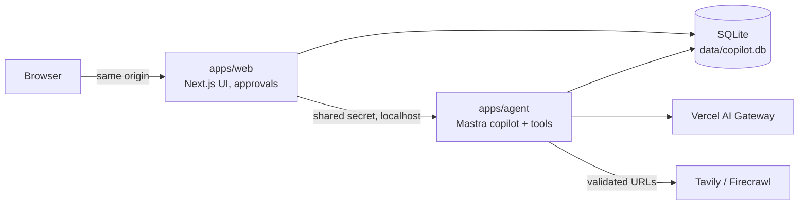

# Job Research Copilot

A private, single-user chat assistant that assesses job listings against your approved personal profile and researches the companies behind them. Built with [Mastra](https://mastra.ai) and Next.js as a hands-on tour of the full agent stack: tools, memory, human approvals, compaction, durable streaming, traces and evals.

Paste a LinkedIn or job-board URL (or the listing text), and the copilot:

- reads the listing and gives a quick assessment: strengths, weaknesses, hard conflicts, unknowns, recruiter questions;
- saves that assessment automatically as the job's current version, keeping earlier versions;
- researches the company on request, within a time/cost/tool budget, citing sources and evidence quality;
- asks focused questions and **proposes** profile updates, which only take effect after you approve them;
- compares jobs with your saved ones later.

Intent and constraints: [project-brief.md](project-brief.md). Decisions and milestones: [docs/PLAN.md](docs/PLAN.md).

**Hosted:** https://job-copilot-c456e8.fly.dev (Fly.io app `job-copilot-c456e8`, region `fra`; password login, private). Every push to `main` deploys there via GitHub Actions. See [docs/deploy.md](docs/deploy.md).

## How it works



The model chooses tools and follow-up questions; deterministic app code owns approvals, budgets, URL validation and every database write. Approvals are database rows the agent can create but never decide.

**Full walkthrough with diagrams (agent logic, tools, human-in-the-loop approvals, memory, research, durable runs, data model): [docs/architecture.md](docs/architecture.md).**

## Stack

pnpm workspaces + Turborepo · TypeScript · Mastra (agent server + Studio, Observational Memory, durable agents, scorers) · Next.js App Router + AI SDK UI + shadcn/ui · libSQL (SQLite) + Drizzle · DuckDB for traces · Vercel AI Gateway (Claude Sonnet / Haiku) · Tavily + Firecrawl · Biome · Vitest · Playwright.

```
apps/agent       Mastra server: agents, tools, memory, durable chat runs, scorers, evals
apps/web         Next.js UI: chats, /jobs, /profile, profile approvals, proxy to the agent
packages/db      Drizzle schema, migrations, data access, profile approval state machine
packages/shared  Zod schemas and types shared by both apps
fixtures/        synthetic listings and web pages for tests and evals
scripts/         env setup, per-checkout ports, dev helpers
docs/            plan, architecture, spikes, verification results
```

## Getting started

Requirements: Node ≥ 22.13, pnpm 12. Keys: a Vercel AI Gateway key for the models, and Tavily (required for URLs and research) plus optionally Firecrawl for web access.

```bash
pnpm install
```

```bash
pnpm setup:env
```

This creates `apps/agent/.env` and `apps/web/.env.local` with a shared secret. Then add your keys to `apps/agent/.env` (see [.env.example](.env.example) for all variables).

```bash
pnpm db:migrate
```

```bash
pnpm dev
```

Open http://127.0.0.1:3000 for the chat and http://127.0.0.1:4111 for Mastra Studio (traces, agents, scorers). In a git worktree, ports differ: `scripts/ports.sh` prints them.

No keys? Set `LLM_MODE=mock` (deterministic fake model) and `WEB_MODE=fixture` (serves `fixtures/web/`) in `apps/agent/.env` to run fully offline.

## Commands

| Command | What it does |
| --- | --- |
| `pnpm dev` | Agent server + Studio and the web app |
| `pnpm check` | Biome + typecheck + unit tests (also the pre-commit hook) |
| `pnpm e2e` | Playwright on an isolated mock stack (stop `pnpm dev` first) |
| `pnpm eval` | Live eval suite: real copilot + LLM judges on fixtures (costs money), report in `data/eval-report.md` |
| `pnpm eval:studio` | Studio on the eval database to browse experiments |
| `pnpm agent:api …` | Authenticated `mastra api`, e.g. `agent run copilot '{"messages":"hi"}'`, `trace list` |
| `pnpm ngrok` | Basic-auth tunnel to the web app |
| `pnpm fly:secrets` | Set the Fly deployment's secrets ([docs/deploy.md](docs/deploy.md)) |

## Using it

- **Chat** (`/c/<id>`): paste a URL or listing, ask for research ("look into their engineering practices and on-call"), state preferences ("remember I don't want regular on-call"), Profile changes it suggests appear as approval cards inline.
- **Jobs** (`/jobs`): saved jobs sorted by latest or best fit; each job page shows the current assessment and its earlier versions. "Re-score" re-assesses jobs whose assessment predates your current profile.
- **Profile** (`/profile`): the facts the copilot may use, with history; your edits here apply right away.
- **Discovery** (`/discovery`): new jobs from Himalayas (free API) and LinkedIn (via Apify, `APIFY_API_KEY`), twice a day while the main checkout's `pnpm dev` runs with `DISCOVERY_SCHEDULE=on`, or on demand with "Run now" / "Backfill". New jobs are then triaged against your profile (a 0–100 score with a one-line reason; low scores are hidden), the best matches of each run get a full assessment, and the matches are emailed to you (Resend: `RESEND_API_KEY`, `DIGEST_TO`). Shows each source's health, every run's results, funnel and cost, and what the screen dropped. **Search settings** (`/settings/search`) hold the search phrases, the screen (title excludes, regions, salary floor, max age) and the Apify caps; saving re-screens recent postings. Set a usage limit in Apify Console (Billing → Usage limit) as a backstop to the app's monthly budget.
- **Technical panel** (chat header): tokens, estimated cost, tool calls and links to Studio traces for the chat.

## Privacy and safety

Single local user: both servers bind to 127.0.0.1 and the web app calls the agent with a shared secret. Secrets stay in server-side env files (never committed, filtered from traces). Fetched web content is treated as untrusted data and can never change your profile. See [docs/architecture.md#safety-boundaries](docs/architecture.md#safety-boundaries).

## Limitations

- Single user: one password login when deployed ([docs/deploy.md](docs/deploy.md)), no multi-user auth. Scheduled discovery fires only while a server with the schedule on is running (the main checkout's dev server, or the Fly machine once `DISCOVERY_SCHEDULE` is on there); missed fires catch up on the next run.
- A run survives a browser refresh, but not an agent-server restart (the run is marked interrupted; partial results are kept).
- Saved-job search is SQLite full-text search, not embeddings.
- Costs and research budgets use a static price table, so they are estimates and soft caps.
- LinkedIn pages often hide the full listing from guests; the copilot then tries the employer's posting or asks you to paste the text.

## Contributing (humans and agents)

Conventions, workflow and per-package notes are in [AGENTS.md](AGENTS.md) and the `AGENTS.md` files next to the code. Verification results for live integrations: [docs/verification.md](docs/verification.md).
