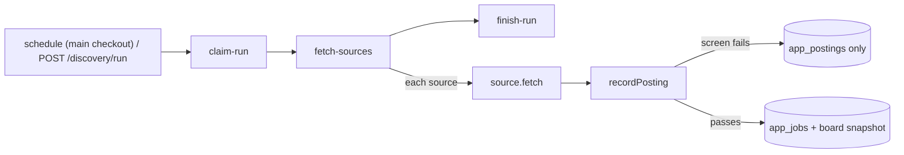

# src/discovery — scheduled job discovery

Fetches new postings from job boards, screens them, and stores the passing ones as jobs. Plan and milestones: [docs/PLAN.md](../../../../docs/PLAN.md#job-discovery-agreed-2026-11-10).

- **Workflow:** `src/mastra/workflows/discover-jobs.ts` (`discover-jobs`). Its steps are claim, then fetch, then finish.
  - **Claim** allows one run at a time. A second trigger is skipped, and the route answers 409.
  - **Fetch** calls `runDiscoverySources` (`run.ts`). Every source runs, and its result is recorded as soon as that source finishes. A failing source never stops the others.
  - **Finish** marks the run `failed` only when every source that ran failed.
  - **Interrupted runs:** runs left `running` by a crash are swept to `interrupted` at startup (`getAppDb`).
- **Schedule:** `0 7,16 * * *` in `DISCOVERY_TZ`.
  - It is declared only when `discoveryScheduleEnabled()`: `DISCOVERY_SCHEDULE=on`, the agent on the main checkout's port 4111, and no `DATABASE_URL` override.
  - Worktrees, e2e and evals never schedule. They copy `.env` and the database, so this check matters.
  - Where the schedule is off, `index.ts` deletes a copied `wf_discover-jobs` schedule row at boot.
  - Missed fires (laptop asleep) aren't replayed. The next run catches up from each source's last good run.
- **Manual run:** `POST /discovery/run` takes `{ lookbackDays?: 7 | 30 }` and is called from the web's "Run now" and "Backfill". A backfill:
  - looks back that many days
  - lets the screen accept postings that old
  - raises the paid sources' per-run caps 4×
- **Per source, per run** (`runDiscoverySources`):
  - **`since`:** the source's last good run minus 1 h, never further back than `maxAgeDays` (or the backfill window).
  - **`knownIds`:** board ids stored in the last 30 days, so a paid source can skip them.
  - **`maxUsd`:** the source's per-run cap, never more than what's left of `apifyMonthlyBudgetUsd` (spend summed from `app_discovery_runs` over 30 days).
  - **Skipped** (`skipped` with a reason) when the source is off in the settings, unavailable (no key), or over budget.
- **Sources** (`sources/`): each implements `JobSource` (`types.ts`).
  - **Pure parsing:** `parse…` functions validate every item against `postingInputSchema`. Bad items are counted as `invalid`, not stored. Descriptions become link-free markdown (`text.ts`).
  - **HTTP:** goes through `sources/http.ts`, which adds a timeout, a size cap, `withRetry`, and errors that name only the host and status.
  - **Errors:** a `SourceError` message is shown on the Discovery page, so it must never contain a secret.
  - **Himalayas** (`himalayas.ts`): free official API (`/jobs/api/search`), `sort=recent`, paged until a page is older than `since`.
    - Terms: apply through `applicationLink` and show credit (the web app links the source).
    - Data refreshes daily. `HIMALAYAS_API_KEY` is optional.
  - **LinkedIn** (`linkedin.ts`): the Apify actor `valig/linkedin-jobs-scraper` (pay per result, about $0.36 per 1,000; prices in `LINKEDIN_PRICES`).
    - Runs one actor search per query × location, with `datePosted` covering `since`, `titleExclude`, `skipJobId` and per-run caps.
    - Guest data has no remote flag; the `f_WT` URL parameter is ignored. So `remote` stays null unless the location says "Remote", and triage decides.
  - **Apify runner** (`apify.ts`, REST, no SDK):
    - Starts the run with `maxTotalChargeUsd`, waits within our own deadline, aborts the run if it overruns, then reads the dataset.
    - 401 and 402 fail the whole source. FAILED fails one search. TIMED-OUT and ABORTED keep their items as partial.
    - Cost is estimated from `chargedEventCounts` × prices.
    - Proxies are part of the event price, so there is nothing to configure.
  - **Fixtures:** with `WEB_MODE=fixture`, `sources/index.ts` serves `fixtures/sources/` (dates shifted to "a day ago") instead of the live APIs.
- **Adding a board:** write a `JobSource` (an Apify actor needs an input builder plus an item parser, like `linkedin.ts`). Then add its id to `DISCOVERY_SOURCES` with a label, plus its settings under `sources`, a fixture and tests.
- **Storage and screening** (`@copilot/db` `discovery.ts`, `@copilot/shared` `screening.ts`): see [packages/db/AGENTS.md](../../../../packages/db/AGENTS.md#discovery).
  - The screen is deliberately permissive: it never requires a title match, and unknown fields pass.
  - Triage and assessment (M14) do the real filtering.
