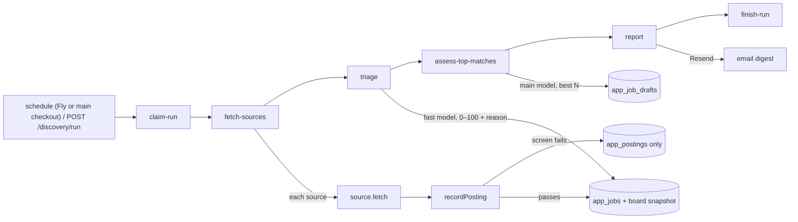

# src/discovery — scheduled job discovery

Fetches new postings from job boards, screens them, and stores the passing ones as jobs. Plan and milestones: [docs/PLAN.md](../../../../docs/PLAN.md#job-discovery-agreed-2026-11-10).

- **Workflow:** `src/mastra/workflows/discover-jobs.ts` (`discover-jobs`). Its steps are claim, fetch, triage, assess, report, then finish.
  - **Claim** allows one run at a time. A second trigger is skipped, and the route answers 409.
  - **Fetch** calls `runDiscoverySources` (`run.ts`). Every source runs, and its result is recorded as soon as that source finishes. A failing source never stops the others.
  - **Finish** marks the run `failed` only when every source that ran failed.
  - **Interrupted runs:** runs left `running` by a crash are swept to `interrupted` at startup (`getAppDb`).
- **Schedule:** `0 7,16 * * *` in `DISCOVERY_TZ`.
  - It is declared only when `discoveryScheduleEnabled()`: `DISCOVERY_SCHEDULE=on`, and either the production image (`NODE_ENV=production`, the Fly machine) or the main checkout's dev server (port 4111, no `DATABASE_URL` override). Never on in both: two schedules, two bills and emails.
  - Worktrees, e2e and evals never schedule. They copy `.env` and the database, so this check matters.
  - Where the schedule is off, `index.ts` deletes a copied `wf_discover-jobs` schedule row at boot.
  - Missed fires (laptop asleep) aren't replayed. The next run catches up from each source's last good run.
- **Manual run:** `POST /discovery/run` takes `{ lookbackDays?: 7 | 30 }` and is called from the web's "Run now" and "Backfill". A backfill:
  - looks back that many days
  - lets the screen accept postings that old
  - raises the paid sources' per-run caps 4×
- **Per source, per run** (`runDiscoverySources`):
  - **`since`:** the source's last fully good (`ok`) run minus 1 h, never further back than `maxAgeDays` (or the backfill window). A `partial` run (one search failed, or the spend cap stopped the searches) doesn't move it, so the next run asks for that window again; known postings are skipped (LinkedIn gets up to 3,000 known ids as `skipJobId`, so repeats aren't billed).
  - **`knownIds`:** board ids stored in the last 30 days, so a paid source can skip them.
  - **`maxUsd`:** the source's per-run cap, never more than what's left of `apifyMonthlyBudgetUsd` (spend summed from `app_discovery_runs` over 30 days).
  - **Skipped** (`skipped` with a reason) when the source is off in the settings, unavailable (no key), or over budget.
- **Sources** (`sources/`): each implements `JobSource` (`types.ts`).
  - **Pure parsing:** `parse…` functions validate every item against `postingInputSchema`. Bad items are counted as `invalid`, not stored. Descriptions become link-free markdown (`text.ts`).
  - **HTTP:** goes through `sources/http.ts`, which adds a timeout, a size cap, `withRetry` (honouring a 429/5xx `Retry-After` up to 60 s), and errors that name only the host and status. A longer `Retry-After` becomes a `CooldownError`: the source stops asking for this run and keeps what it has (partial).
  - **Failed searches:** a source reports them in `failures` (a partial run caused only by a cap has none); they are emailed as problems.
  - **Errors:** a `SourceError` message is shown on the Discovery page, so it must never contain a secret.
  - **Himalayas** (`himalayas.ts`): free official API (`/jobs/api/search`), `sort=recent`, paged until a page is older than `since`, with a 1.1 s pause between requests.
    - Terms: apply through `applicationLink` and show credit (the web app links the source).
    - Data refreshes daily. `HIMALAYAS_API_KEY` is optional.
  - **Free feeds** (`feed.ts` loop: fixed requests one by one with a 1 s pause, one failing request never loses the others). Nothing is dropped by date: Remotive publishes a day late with the original date; known postings only count as seen, and the age screen drops old ones. Each needs credit and a followed link back to the job on the board (the job page's "Seen on" links do both):
    - **We Work Remotely** (`weworkremotely.ts`): RSS per category from settings, full descriptions, a region ("USA Only"). Titles are "Company: Role".
    - **Remote OK** (`remoteok.ts`): `/api`, the latest ~100 jobs of every kind (no search). Salary fields are often garbage, so only a plausible yearly USD range is kept; free-text locations never restrict regions.
    - **Remotive** (`remotive.ts`): `/api/remote-jobs`, a small 24 h-delayed set (search parameters are ignored); terms ask for at most ~4 requests a day.
    - **NoDesk** (`nodesk.ts`): RSS per category, about 10 items each, descriptions cut to the opening. Titles are "Role at Company".
    - `rss.ts` is a minimal RSS 2.0 reader (no dependency); `regionList` (`text.ts`) turns region text into regions and returns none when unclear.
  - **Apify boards** (`actor-source.ts` loop shared with LinkedIn: one actor run per search until the per-run cap is spent, every valid item kept (it's paid for); definitions in `boards.ts`, checked live 2026-11-10):
    - **YC Work at a Startup** and **Jobgether** (`nomad-agent/*`, ~$0.10 per 1,000): one run for all phrases, remote only. Matching includes descriptions, so off-target titles come back for triage. The actors' server-side repeat suppression is off (we keep our own record). A list of more than 50 applicant countries counts as unrestricted.
    - **Built In** (`solidcode/builtin-scraper`, ~$1.07 per 1,000, billed in pages of 25): one run for all phrases, `remoteMode: "remote"` (loose). `workplaceType` decides remote (`isRemote` is true on hybrid roles); currency is often missing.
    - **Wellfound** (`clearpath/wellfound-api-ppe`, ~$2.80 per 1,000): role pages from settings, one page each, remote only, no per-item limit (the spend cap stops it). No apply URL.
    - **HiringCafe** (`memo23/apify-hiring-cafe-scraper`, ~$1.25 per 1,000): one run per phrase, remote, slow (~2 min). ATS apply URLs; some descriptions arrive URL-encoded or missing (the requirements summary is the fallback).
    - **Dice** (`shahidirfan/Dice-Job-Scraper`, ~$1 per 1,000): off by default; it has no remote-only filter, so most results are on-site US roles the screen drops. Pay is free text with mixed periods, kept as text only.
    - **Company career sites** (`fantastic-jobs/career-site-job-listing-feed`, $0.002 per job, at least 200 per run, ~$0.40): employers' own postings on Greenhouse, Lever, Ashby, Workday, Workable and ~50 more ATS, with AI-read remote region, pay and experience. One run for all phrases: remote only, title excludes and blocked companies passed on, agencies and Jobgether's reposts left out. The feed has no "since": it returns every matching active job newest first (200 ≈ the last 5 days), so it runs at most every `minHoursBetweenRuns` (20 h; skipped otherwise, except a backfill) and repeats count as seen. The same role listed per office is kept once per run (`onePerTitle`). Snapshots are `ats` sources.
    - Not added: Welcome to the Jungle (the checked actor ignored the query and costs ~$3 per 1,000; try `blackfalcondata/wttj-scraper` first). Not used: the same vendor's `career-site-job-listing-api` (has a time range, but $0.012 per job) and a hand-built Greenhouse/Lever/Ashby/Workable resolver (free, but it can only re-read jobs we already link to, and boards already give full descriptions); ATS links still give the strongest dedupe key (`ats_key`, [packages/db/AGENTS.md](../../../../packages/db/AGENTS.md#discovery)).
  - **LinkedIn** (`linkedin.ts`): the Apify actor `valig/linkedin-jobs-scraper` (pay per result, about $0.36 per 1,000; prices in `LINKEDIN_PRICES`).
    - Runs one actor search per query × location, with `datePosted` covering `since`, `titleExclude`, `skipJobId` and per-run caps.
    - Guest data has no remote flag; the `f_WT` URL parameter is ignored. So `remote` stays null unless the location says "Remote", and triage decides.
  - **Apify runner** (`apify.ts`, REST, no SDK):
    - Starts the run with `maxTotalChargeUsd`, waits within our own deadline, aborts the run if it overruns, then reads the dataset.
    - 401 and 402 fail the whole source. FAILED fails one search. TIMED-OUT and ABORTED keep their items as partial.
    - Cost is estimated from `chargedEventCounts` × prices.
    - Proxies are part of the event price, so there is nothing to configure.
  - **Fixtures:** with `WEB_MODE=fixture`, `sources/index.ts` serves `fixtures/sources/` (dates shifted to "a day ago") instead of the live APIs.
- **Adding a board:** a free feed is a `createFeedSource` call, an Apify actor an `ActorBoard` in `boards.ts` (input builder + item parser). Then add its id to `DISCOVERY_SOURCES` with a label and site (and to `PAID_DISCOVERY_SOURCES` if paid), its settings under `sources`, the settings form, a fixture or a test, and check one tiny live run.
- **Source stats** (`sourceStatsSince`, `/discovery` cards): last 30 days per source — postings and screen passes, matches (triage at or above the threshold, kept or acted on) and matches no other board had, overlap with other boards, cost per match. Use them to turn off boards that don't pay off.
- **Funnel** (`funnel.ts`, after fetching). Each step records the run's `funnel` as it finishes; an unexpected error is recorded as `stoppedBy` instead of failing the run.
  - **Triage** (`triage.ts`): `triagerAgent` (fast model, no tools, structured `triageSchema`) scores every untouched discovered job without a score, newest first, 5 at a time, up to `maxTriagePerRun`. The prompt puts the marker, profile and criteria first (cacheable) and the untrusted posting last. App code caps the score at 39 when the model names a hard conflict. A failed call leaves the job "triage pending" for the next run.
  - **Assess** (`assess.ts`): the run's best matches (triaged in this run, at or above `triageThreshold`, no draft yet), best first, up to `maxAssessmentsPerRun`, through `assessJob` (shared with re-score; `saveDraft` rules apply).
  - **Budget** (`budget.ts`): per run, `maxLlmUsdPerRun` and `maxTriagePerRun`. Triage reserves $0.002 per call and settles with real tokens; assessments reserve $0.08. What stopped it goes into `stoppedBy`.
  - **Usage:** every model call is an `app_run_events` row under the `app_runs` row whose id is the discovery run id and whose thread is `discovery:<runId>`. The funnel's `llmUsd` is summed from those events.
  - **Report** (`report.ts`): the run's matches (`digestMatches`) go to `DIGEST_TO` through Resend (`RESEND_API_KEY`, `DIGEST_FROM`, links to `APP_BASE_URL`), with a "Needs a look" block on top when the run had problems (`runProblems`: failed sources and failed searches, paid sources skipped for the monthly budget, sources empty two runs in a row, triage or assessment calls failing (3+ and at least 10%, or all), failed funnel steps; the per-run caps are expected and don't count). Without matches, problems go out as a short alert, at most once per 24 hours for the same problems: the throttle compares stable keys (`linkedin:failed`, `triage:calls-failed`, …), not messages, over every run of the last 24 hours. Every value is HTML-escaped and links point only to the app. Resend's default test sender (`onboarding@resend.dev`) only delivers to the Resend account's own address.
  - **Mock model:** a prompt starting with `TRIAGE_MARKER` gets a deterministic triage (88 for "Founding", 35 for "intern", else 70), so e2e runs the whole funnel offline.
- **Storage and screening** (`@copilot/db` `discovery.ts`, `@copilot/shared` `screening.ts`): see [packages/db/AGENTS.md](../../../../packages/db/AGENTS.md#discovery).
  - The screen is deliberately permissive: it never requires a title match, and unknown fields pass.
  - Triage and assessment do the real filtering.
