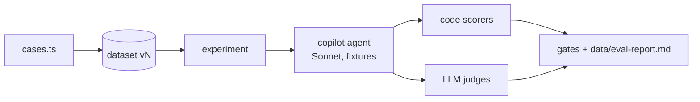

# Evals

Mastra scorers, datasets and experiments for the copilot.

- `scorers.ts`: all scorers. Registered on the Mastra instance (`allScorers`), so Studio lists them and scores persist.
  - Code: `check-no-tool-errors` (built-in), `draft-after-listing`, `role-only-without-profile`, `case-expectations` (eval cases only: `mustCall` / `mustNotCall` / `fitBasis` from ground truth).
  - LLM judges (`EVAL_JUDGE_MODEL`, default `openai/gpt-6.1-sol` via the AI Gateway): `copilot-quality` (generic rubric, score = share of applicable criteria passed) and `case-rubric` (eval cases only: binary, case `must` / `mustNot`). Judges get user text, the approved profile, tool calls with results (clipped) and the reply, and treat all of it as data.
  - Not-applicable runs return `notScorable()` and store no score.
- Live scoring (`liveCopilotScorers` on the copilot, only with `LLM_MODE=live`): code scorers on every turn, `copilot-quality` on 10%. A `requestContext.evalRun` filter keeps them off eval experiments. Judge calls show as scorer traces in Studio, not in the chat's usage panel.
- `cases.ts`: two suites (datasets): `copilot-no-profile` (10 cases) and `copilot-with-profile` (2 cases, seeded profile). Single turn, fresh thread each. Listings come from `fixtures/listings`, research reads `fixtures/web`.
- `copilot.eval.ts` (`pnpm eval`, config `vitest.eval.config.ts`): start it as `scripts/wait-for-idle.sh && pnpm eval` (other worktrees may be busy, see root AGENTS.md). Real models, `WEB_MODE=fixture`, own database `data/eval.db` (refuses any other). Per suite: empty all app tables (`resetAppTables`), seed the profile through propose → approve, sync the dataset (new version when cases change), run one experiment. Gates (per case, must be 1 where scorable): every code scorer and `case-rubric`. `copilot-quality` must average ≥ 0.8 per suite. Writes `data/eval-report.md`.
- `rescore.eval.ts` (also `pnpm eval`): the live batch rescorer on three fixture listings against the seeded profile; every job must save a `with_profile` draft whose fit points are inference (rescorer has no retry). Eval files run one at a time (`fileParallelism: false`): each resets the eval DB.
- Flaky behaviour: `EVAL_ONLY=<case name substring> EVAL_REPEAT=<n> pnpm eval` runs matching cases n times into separate `<suite>-adhoc` datasets (main datasets keep their history). `EVAL_ONLY=rescorer` runs only the rescorer suite; any other `EVAL_ONLY` skips it.
- Browse results: stop `pnpm dev`, run `pnpm eval:studio` (Studio on the eval DB), then Datasets → Experiments (per-item output, scores, reasons, traces; compare runs).

Judge scores are evidence to read, not truth: check the reasons in Studio before changing prompts.
