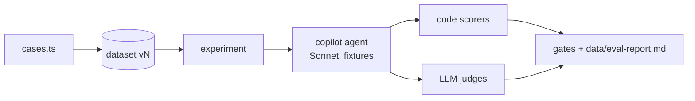

# Evals

Mastra scorers, datasets and experiments for the copilot.

- `scorers.ts`: all scorers. Registered on the Mastra instance (`allScorers`), so Studio lists them and scores persist.
  - Code: `no-tool-errors` (any failed call, even one the model retried; the reason names each tool and error), `draft-after-listing`, `role-only-without-profile`, `case-expectations` (eval cases only: `mustCall` / `mustNotCall` / `fitBasis` from ground truth; `fitBasis` counts only drafts that saved). Unit tests: `scorers.test.ts`.
  - LLM judges (`EVAL_JUDGE_MODEL`, default `openai/gpt-6.1-sol` via the AI Gateway): `copilot-quality` (generic rubric, score = share of applicable criteria passed) and `case-rubric` (eval cases only: binary, case `must` / `mustNot`). Judges get user text, the approved profile, tool calls with results (clipped) and the reply, and treat all of it as data.
  - Not-applicable runs return `notScorable()` and store no score.
- Live scoring (`liveCopilotScorers` on the copilot, only with `LLM_MODE=live`): code scorers on every turn, `copilot-quality` on 10%. A `requestContext.evalRun` filter keeps them off eval experiments. Judge calls show as scorer traces in Studio, not in the chat's usage panel.
- `cases.ts`: two suites (datasets): `copilot-no-profile` (10 cases) and `copilot-with-profile` (2 cases, seeded profile). Single turn, fresh thread each. Listings come from `fixtures/listings`, research reads `fixtures/web`.
- `copilot.eval.ts` (`pnpm eval`, config `vitest.eval.config.ts`): start it as `scripts/wait-for-idle.sh && pnpm eval` (other worktrees may be busy, see root AGENTS.md). Real models, `WEB_MODE=fixture`, own database `data/eval.db` (refuses any other). Per suite: empty all app tables (`resetAppTables`), seed the profile through propose → approve, sync the dataset (new version when cases change), run one experiment. Gates (per case, must be 1 where scorable): every code scorer and `case-rubric`. `copilot-quality` must average ≥ 0.8 per suite. Writes `data/eval-report.md`.
- `rescore.eval.ts` (also `pnpm eval`): the live batch rescorer on three fixture listings against the seeded profile; every job must save a `with_profile` draft that cites profile facts (fit points are stored as inference; the rescorer retries once on a rejection), and the remote-first job must state remote fit conditionally (keyword heuristic, not a judge). Eval files run one at a time (`fileParallelism: false`): each resets the eval DB.
- `rescore-models.eval.ts` (opt-in, costs money): compares rescorer configs (`model[:reasoning]`, AI SDK's portable reasoning effort) on 10 synthetic trap listings (`rescore-models-cases.ts`: light hybrid that meets the rule, US-only "remote", monthly pay, German C1, people management, contradictory remote, …) against its own 8-fact profile. Per run: valid draft, deterministic verdict / fit / hard-conflict / location-block checks, and a per-criterion judge rubric. Cost is the gateway-reported `cost` per call. Run `EVAL_MODELS=default pnpm eval rescore-models` (or a comma list), with `EVAL_REPEAT` (default 2), `EVAL_CASES` (name substring) and `EVAL_BUDGET_USD` (default 10; once reached, aborts calls in flight and starts no new ones, retries and judge calls included). Writes `data/rescore-models-report.md`, `data/rescore-models-results.json` (full assessments and judge reasons, saved after every run) and `data/rescore-models-profile.txt` (the profile they were written against). Skipped unless `EVAL_MODELS` is set. `EVAL_REJUDGE=<model>` re-grades the saved results against that profile snapshot (judge-bias check). `EVAL_REAL=1` compares the first two configs on real jobs instead: copy a real database to `data/eval.db` first (`sqlite3 <db> ".backup data/eval.db"`; delete any old `eval.db-wal`/`-shm`). It samples `EVAL_REAL_SAMPLE` jobs (default 150: every job with a status other than new, half of the rest with triage ≥ 60, half random; fixed seed), assesses each `EVAL_REPEAT` times per config (#1 vs #2 is the noise baseline), then a blind pairwise judge (`EVAL_PAIR_JUDGE`, default Opus 5.5) compares #1 of each in both orders; a win must hold in both. Writes `data/rescore-models-real.md` and `.json` (real data, stays local).
- `triage.eval.ts` (also `pnpm eval`): the live discovery triager (fast model) against the seeded profile on seven postings: a clear remote platform match (`remote-platform-match.md`) must score ≥ 75, three office days in Lisbon (`ats-complete.md`) must be named as a conflict and capped ≤ 39, the injected posting (`injection.md`) must get an ordinary score (< 90) with no compliance in the reason; explicit US-only and UK-only restrictions (`remote-us-only.md`, `remote-uk-only.md`) must be location blocks (capped, hidden), US-hours overlap and "remote-first in European time zones" (`remote-us-hours.md`, `remote-ambiguous.md`) and the clear match must not. `EVAL_ONLY=triage` runs only these. The funnel's budget is covered by unit tests (`src/discovery/funnel.test.ts`), not here.
- `scenarios.eval.ts` (also `pnpm eval`): multi-turn, multi-chat scenarios with the real copilot (`createCopilotBaseAgent`); app code plays the user's Approve click. Code checks read the DB, working memory and OM observations; `case-rubric` judges the decisive turn. Scenarios: memory across chats (chat A's local exception stays in A, its approved requirement reaches chat B), compaction (low OM threshold; the approved profile and a pending proposal survive it), comparison with stale assessments (role-only drafts made before the profile). `EVAL_ONLY=scenario` runs only these; a scenario-name substring (`memory`, `compaction`, `stale`) runs one.
- Flaky behaviour: `EVAL_ONLY=<case name substring> EVAL_REPEAT=<n> pnpm eval` runs matching cases n times into separate `<suite>-adhoc` datasets (main datasets keep their history). `EVAL_ONLY=rescorer` runs only the rescorer suite; any other `EVAL_ONLY` skips it.
- Browse results: stop `pnpm dev`, run `pnpm eval:studio` (Studio on the eval DB), then Datasets → Experiments (per-item output, scores, reasons, traces; compare runs).
- Quick look from plain `pnpm dev`: when `data/eval.db` exists, `storage.ts` reads the datasets and experiments domains from it, so Studio lists datasets, items and per-item results. Scores and traces stay in the eval DB, so they are missing there. Datasets created or edited in the dev Studio are written to the eval DB.

Judge scores are evidence to read, not truth: check the reasons in Studio before changing prompts.
