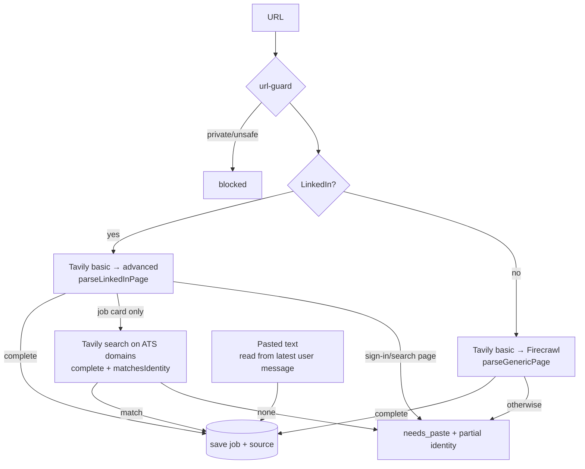

# Listing ingestion

`ingest_listing` (`src/mastra/tools/ingest-listing.ts`) → `ingest.ts`. Provider choice and failure shapes: [docs/spikes/extraction.md](../../../../docs/spikes/extraction.md).

- `url-guard.ts`: http(s), default ports, no credentials or local hostnames, every DNS answer public. Re-run on the provider's final URL. Our server never fetches listing URLs itself.
- `listing.ts`: pure parsing. "Join or sign in" text appears on every LinkedIn guest page, so completeness means job card + criteria block + ≥ 80-word description, never "no sign-in text".
- Only complete listings are saved from URLs; pasted text is always saved (flagged `complete: false` under 150 words). Jobs dedupe in `@copilot/db` (`upsertJob`); sources are idempotent per job + content.
- Tool output carries `notice` (untrusted text). Provider errors expose status codes only.
- Tests use fake providers and `fixtures/listings/` (synthetic). Live checks: [docs/verification.md](../../../../docs/verification.md).
