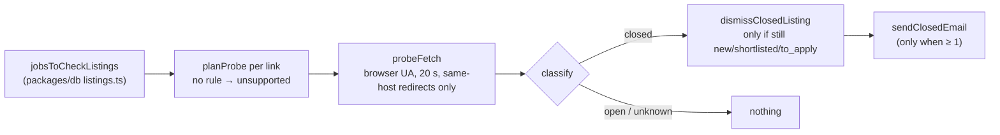

# src/listings — closed listing check

Daily, the `check-listings` workflow (`src/mastra/workflows/check-listings.ts`, `30 6 * * *` in `DISCOVERY_TZ`, scheduled where discovery is: `discoveryScheduleEnabled()`) re-checks the links of **shortlisted and to-apply jobs and new jobs scored at least `digestThreshold`** (plus chat jobs), dismisses those whose listing closed, and emails the list. Only `new`, `shortlisted` and `to_apply` jobs are ever dismissed; a job the user restores is never dismissed again (`listing_closed_at` stays set).

- `checkers.ts`: one rule per site, each proven on real listings (`corpus.json`). Closed only on the exact verified signal; anything else (429, 403 bot walls, 5xx, redirects to another host, unexpected pages) is `unknown` and changes nothing.

  | Site | Fetched | Closed when |
  | --- | --- | --- |
  | LinkedIn | guest `jobs-guest/jobs/api/jobPosting/<id>` | `closed-job__flavor--closed` ("No longer accepting applications") or 404 (removed) |
  | Greenhouse, Lever | public job API | 404 |
  | Ashby | the job page | 404 ("Job not found") |
  | Workable (`jobs.workable.com/view`) | the page | 410 |
  | Dice, Jobgether | the page | 410 plus the site's expired text |
  | NoDesk | the page | the red "career opportunity is no longer available" banner |

- Traps (in the unit tests and the corpus): a LinkedIn page without an Apply button is still open; an Ashby job missing from the company's board API can be live (unlisted); Jobgether and NoDesk say "expired" in a report-this-job menu on every page; Lever's API is case-sensitive (`urlSpelling` keeps the company as the URL spells it, `atsKey` lowercases it).
- Not checked: Himalayas, We Work Remotely, Hiring Cafe (Cloudflare), Wellfound (redirects), Built In, Remote OK, Remotive, YC, company career sites. Their ATS apply links are checked when the job has one.
- One closed link is enough: employers close first (an Ashby job gone while its LinkedIn copy still shows).
- `run.ts`: one request at a time, 1.5 s between LinkedIn requests (0.5 s elsewhere); a 429 stops that site for the run. `dryRun` reports without writing or emailing.
- `report.ts`: the email (`🧹 N jobs no longer available`), to-apply then shortlisted first (subject counts both), links to the job in the app. Sending via `src/email.ts` (shared with the discovery digest).
- Run by hand: Studio → Workflows → `check-listings` (`{"dryRun": true}` first), or `pnpm agent:api workflow …`.
- `pnpm listings:live` re-checks `corpus.json` live (not part of `pnpm check`). A closed entry that reads otherwise means a site changed: fix its rule. An open control that closed is only reported: replace it with a fresh open listing.
- Adding a site: find closed and open listings in the production data, confirm them in a browser, add the rule, synthetic unit cases and corpus entries.
