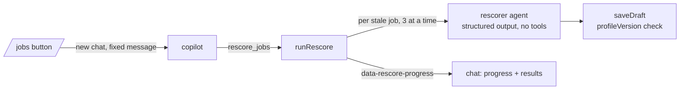

# Batch re-score

`rescore_jobs` (`src/mastra/tools/rescore-jobs.ts`) → `runRescore` (`run.ts`). Started by the copilot, usually from the "Re-score" button on `/jobs` (a server action that starts the run in a new chat and opens it).

- One fresh model call per job (profile + stored listing via `latestListingSource` + the job's research claims), so cost grows linearly. At most `MAX_RESCORE_JOBS` (25) per batch; the rest are reported as `skipped`.
- Default set: jobs whose current assessment predates the current profile (`profileStale`). `jobIds` re-scores specific jobs.
- `saveDraft` gets the profile version the prompt used and rejects the assessment if the profile moved meanwhile. Each saved result is the job's new current version (no approval) and stays if the run is stopped.
- Usage is recorded as actor `rescorer`. Offline: the mock model answers structured output with a fixed `with_profile` assessment citing the listing source.
