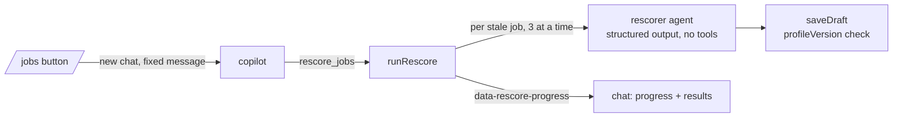

# Batch re-score

`rescore_jobs` (`src/mastra/tools/rescore-jobs.ts`) → `runRescore` (`run.ts`). Started by the copilot, usually from the "Re-score" or "Re-score all" button on `/jobs` (a server action that starts the run in a new chat and opens it).

- One fresh model call per job (profile + stored listing via `latestListingSource` + the job's research claims), so cost grows linearly. At most `limit` jobs per batch (default `DEFAULT_RESCORE_LIMIT`, 25; `"all"` has no cap); the rest are reported as `skipped`. The `/jobs` buttons pick 25, 100, 1000 or all (`RESCORE_BATCH_SIZES`), and the server action only accepts those.
- The UI gets every result; the model gets them through `toModelOutput`, so a batch over 25 reaches it as counts (saved, verdict/fit changed, failed) plus the failures, not one entry per job.
- Default set: jobs whose current assessment predates the current profile (`profileStale`). `all` takes every assessed active job (the "Re-score all" button on `/jobs`, behind a confirm dialog; e.g. to fill in fields added later), stale first, then least recently updated, so repeated batches work through the list. `jobIds` re-scores specific jobs.
- The model answers `modelAssessmentSchema` (no length limit on headline or salary); `normalizeModelAssessment` drops an empty salary and cuts a long headline at a word before the strict schema. `saveDraft` relabels a point citing profile facts as `inference` instead of rejecting it. One retry remains for other rejections.
- `saveDraft` gets the profile version the prompt used and rejects the assessment if the profile moved meanwhile. Each saved result is the job's new current version (no approval) and stays if the run is stopped.
- Model: `RESCORE_MODEL` (default `COPILOT_MODEL`) with optional `RESCORE_REASONING` (AI SDK's portable effort, none … max), via `getRescoreModel()`; also used by discovery's full assessments (`assessJob`). Compare configs with `rescore-models.eval.ts` ([../evals/AGENTS.md](../evals/AGENTS.md)) before switching, and add the model to `usage/prices.ts`. OpenAI's strict JSON mode is turned off (`strictJsonSchema: false`): it rejects the assessment schema's optional fields.
- Usage is recorded as actor `rescorer` under the model actually used. Offline: the mock model answers structured output with a fixed `with_profile` assessment citing the listing source.
