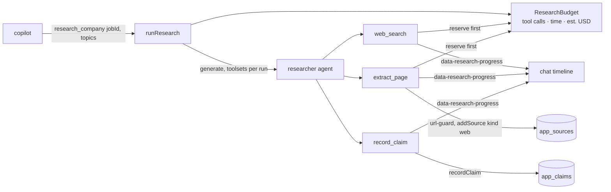

# Company research

`research_company` (`src/mastra/tools/research-company.ts`) → `runResearch` (`run.ts`). Started by the user: in words, or with the "Research next" buttons the UI builds from the draft's `researchTopics` (message from `researchRequestText`: only the job id and topic labels, never listing fields such as the company, since a user message counts as the user's own request).

- The researcher is a plain agent called from a tool, not a Mastra subagent: app code owns the per-run tools, budget and progress events.
- Budget (`budget.ts`): every provider call reserves first; the time limit and the LLM spend estimate (`onStepFinish` usage × static price table) abort the run. Spend is an estimate; a call in flight when a limit hits can still be billed.
- Claims are written as they are found, so `budget_limited` and `cancelled` runs keep partial results. Sourced classes must cite `extract_page` sources of the same job.
- Progress events are real tool events only (no extra LLM calls), persisted with the message so the timeline survives reload.
- Page text is untrusted (`untrustedText`); the researcher and copilot are told never to follow it. `fixtures/web/northwind-funding.md` contains an injection attempt.
- Offline: `WEB_MODE=fixture` serves `fixtures/web/` and resolves `.example` hosts for the URL guard; the mock model searches, reads the top result, records one claim.
