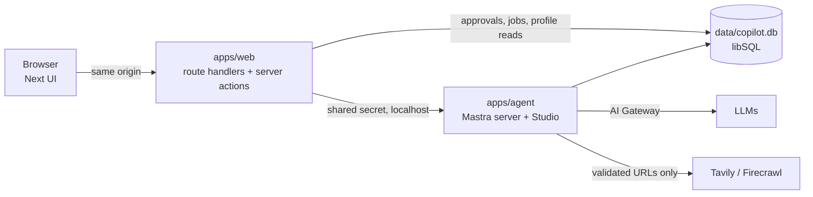

# Implementation Plan — Job Research Copilot

Source of intent: [project-brief.md](../project-brief.md). This file is the milestone plan; each milestone ends in a working, verified, committed state. Update the status column as work lands.

## Decisions (agreed 2026-11-03)

| Area | Choice | Why |
| --- | --- | --- |
| Topology | Separate Mastra server (`apps/agent`, `mastra dev`, :4111) + Next.js UI (`apps/web`, :3000) | Runs live outside Next requests; Studio + `mastra api` CLI give a verification loop |
| Web → agent | Next route handlers / server actions proxy to Mastra; browser never talks to :4111 | Keys stay server-side, one origin, ownership checks in one place |
| Database | libSQL file (`data/copilot.db`): Mastra storage + app tables (Drizzle, `app_*` prefix) | Zero setup, local prototype; Turso later if ever deployed |
| Approvals | DB-backed proposals: `propose_*` tools write a pending row bound to payload hash + version; UI approves; app code applies idempotently | Survives compaction/restarts, approvable later, model can't self-approve |
| Models | Vercel AI Gateway via the native `@ai-sdk/gateway` provider instance (not Mastra's `vercel/` router string, which uses Gateway's OpenAI-compatible endpoint and can drop cache/reasoning usage). Main `anthropic/claude-sonnet-5.5`, fast `anthropic/claude-haiku-5.5`; env-configurable; `LLM_MODE=mock` for a deterministic fake | Reuse Gateway with full usage data |
| Web providers | Tavily (search/extract) + Firecrawl (scrape, optional hosted browser). Final split decided by the M3 spike | Minimal stack |
| Chat UI | shadcn/ui native chat components (MessageScroller, Message, Bubble), Radix base; AI Elements added per component only where it adds value | shadcn guidance; fewer dependencies |
| Agent instructions | `AGENTS.md` only (Claude Code reads it natively) | One file for all coding agents |
| Observability | Mastra native tracing to storage (Studio). No Langfuse | Brief: add platforms only for a concrete gap |
| Compaction | Mastra Observational Memory, thread scope | Native mechanism; no cross-session summaries |
| Session-local context | Thread-scoped working memory (no approval needed) | Idiomatic; global profile stays in app tables |
| Global profile | App-owned versioned tables, injected per turn from DB | Approval + audit history; never sourced from a summary |
| Auth boundary | Single local user, servers bound to 127.0.0.1, shared secret web→agent | Brief allows single-user local mode |

## Stack

pnpm enforces a 24h minimum release age: pin to the newest version older than that; never accept the `minimumReleaseAgeExclude` entries pnpm auto-adds.

pnpm 12 workspaces + Turborepo · TypeScript 6.0 (7.x is native-only with no JS API, which Next needs) · Biome 2 (lint + format) · Vitest 5 · Playwright (system Chrome) · Next.js 16.4 App Router (Cache Components on) · Tailwind 4 · shadcn/ui (Radix Nova) · AI SDK 7 `useChat` · `@mastra/core`, `@mastra/memory`, `@mastra/libsql`, `@mastra/ai-sdk`, `@mastra/observability`, `@mastra/evals` · Drizzle · Zod 4.

## Architecture



Repo layout:

```
apps/web        Next.js UI, API proxy, approval actions
apps/agent      Mastra: agents, tools, memory, durable runs, scorers
packages/shared Zod schemas + types (jobs, evidence, approvals, events)
packages/db     Drizzle schema, migrations, data-access functions (no raw SQL from tools)
fixtures/       synthetic listings/pages + saved public examples (offline evals)
docs/           plan, spikes, decisions
```

## Verification loops

| Loop | Command / mechanism | When |
| --- | --- | --- |
| Format/lint on edit | Claude `PostToolUse` hook → `biome check --write <file>` | Every edit |
| Static checks | `pnpm check` = Biome + typecheck + unit tests (Turbo-cached) | Git pre-commit hook; Claude `Stop` hook (blocks once, feeds errors back) |
| Agent behaviour | `pnpm agent:api agent run copilot '{"messages":"…"}'`, `pnpm agent:api trace list` (wraps `mastra api` with the shared secret) | After agent/tool changes |
| UI | next-devtools MCP (errors/routes), built-in browser / Playwright MCP for screenshots | After UI changes |
| E2E | `pnpm e2e` — Playwright starts its own stack (agent :4112, web :3001, `data/e2e.db`, mock model). Stop `pnpm dev` first: Mastra allows one `mastra dev` per project | Per milestone |
| Evals | `pnpm eval` offline fixtures (deterministic + LLM-judge scorers); `pnpm smoke:live` real providers, costs money, on demand | M4 onward |
| Git | Small commits after every verified step; pre-commit runs `pnpm check` | Always |

Live-integration claims are only made when `smoke:live` actually ran; results recorded in `docs/verification.md`.

## Milestones

Each milestone adds its own deterministic tests and eval fixtures; M9 completes the suite.

### M0 — Repo hygiene & Claude setup ✅ (2026-11-03)
- [x] Remove committed Langfuse key from all history; stale worktrees/branches deleted, objects purged. **You:** rotate the key in Langfuse.
- [x] `.mcp.json`: next-devtools, playwright, chrome-devtools, firecrawl, tavily (both OAuth, no keys in config). Mastra docs MCP skipped: Mastra recommends the skill instead.
- [x] `.claude/settings.local.json` untracked + gitignored; stale MCP entries removed.
- [x] `AGENTS.md` filled and read natively by Claude Code (no `CLAUDE.md`, which would stop it loading).
- [x] Official skills installed: ai-sdk, next-dev-loop, vercel-react-best-practices, shadcn, turborepo (+ mastra).
- [x] Project permissions allowlist; `.env*` reads denied. Hooks (`PostToolUse` format, `Stop` check) are wired in M1 once the scripts exist.

### M1 — Monorepo skeleton + streaming hello agent ✅ (2026-11-03)
- [x] pnpm workspace, Turbo, shared tsconfig, Biome, Vitest, Playwright.
- [x] `apps/agent`: Mastra on 127.0.0.1:4111, SimpleAuth shared secret, libSQL storage, PinoLogger, tracing to storage, Zod env validation, `copilot` agent, `chatRoute` (AI SDK v7), mock model.
- [x] `apps/web`: Next 16.4, Tailwind, shadcn chat components, chat page streaming via `/api/chat` proxy.
- [x] `packages/shared`, `packages/db` (Drizzle + migrations, `app_users`), `.env.example`, `pnpm setup:env`.
- [x] Hooks: Claude `PostToolUse` Biome format, `Stop` → `pnpm check`; git pre-commit → `pnpm check`.
- [x] Verified (mock): browser → proxy → agent stream; 401 without secret; traces via `pnpm agent:api trace list`; `pnpm check` + `pnpm e2e` green.
- [x] Live: real Sonnet 5.5 reply streamed in the UI; trace and usage verified ([verification.md](verification.md)).
- [x] Stream errors reach the client only as a sanitized summary (`chatRoute` `onError`).
- Deferred: Mastra metrics/cost dashboard needs a DuckDB observability store (M8). `chatRoute` aborts generation on client disconnect; durable runs replace it in M7.

### M2 — Chat sessions ✅ (2026-11-03)
- [x] Threads = Mastra memory threads under one resource (`chatMemory`: last 20 messages, no semantic recall or resource working memory). Chat at `/c/<threadId>`; `/` redirects to a fresh id; the agent creates the thread on the first message.
- [x] Sidebar (list, New chat, reopen, rename, delete), history via `/threads/:id/ui-messages` (`toAISdkMessages` v7), auto titles with the fast model (`generateTitle`, streamed `data-thread-title`).
- [x] Ownership: `SimpleAuth` `mapUserToResourceId` pins every memory call to the local resource (Mastra filters lists, 403s foreign threads, rejects mismatched `/chat`). The `/api/chat` proxy accepts only `{ threadId, message }` and builds the agent body itself.
- [x] Spike: durable agent resume works on the Mastra side; `chatRoute` can't be reused for it ([spikes/durable-resume.md](spikes/durable-resume.md)).
- [x] Verified (mock): unit tests for recall, no cross-thread leak, resource mismatch, history scoping, proxy body; e2e for separate histories, reopen after reload, rename/delete, foreign threads hidden and inaccessible.

### M3 — Listing ingestion ✅ (2026-11-03)
- [x] Spike on 5 live LinkedIn URLs ([spikes/extraction.md](spikes/extraction.md)): Tavily extract `basic` reads full guest pages (advanced as retry); Firecrawl refuses LinkedIn (kept as second extractor for other pages); ATS search needs an identity check.
- [x] `ingest_listing`: URL or pasted text (read from the latest user message, not copied by the model); URL guard incl. DNS and final-URL re-check; sign-in/search/truncated detection; ATS fallback with identity check; ask-to-paste fallback; result names the source actually read. Overview: [apps/agent/src/ingest/AGENTS.md](../apps/agent/src/ingest/AGENTS.md).
- [x] Tables `app_jobs` (dedupe: LinkedIn id → canonical URL → normalized company+title without conflicting ids) and `app_sources` (bounded snapshot, provider, URL, thread, retrieved_at; idempotent per job+content).
- [x] UI: Markdown replies (Streamdown, no images/HTML), tool Trace rows.
- [x] Verified: unit tests (guard, parser, dedupe, orchestrator with fixtures), offline e2e for fallback/blocked/pasted paths, live runs ([verification.md](verification.md)).

### M4 — Vertical slice: assessment → draft → approved snapshot ✅ (2026-11-03)
- [x] Assessment shape (`packages/shared/src/assessment.ts`): overview, `fitBasis` (role only vs with profile), strengths/weaknesses, hard conflicts vs soft tradeoffs, unknowns, recruiter questions, qualified recommendation; evidence class + source ids per point; no numeric score.
- [x] `save_job_draft` (automatic, versioned, sources must belong to the job) and `propose_job_snapshot` → `app_approvals` (payload hash, draft version, thread id, idempotency key). State machine: [packages/db/AGENTS.md](../packages/db/AGENTS.md).
- [x] Approval card in chat (state from DB, decision with displayed payload hash); jobs list + detail with draft vs approved versions and sources read.
- [x] Verified: db tests for stale (newer draft, changed hash), cross-chat, duplicate, lost-response retry, concurrent approve, superseded, versioning; offline e2e of paste → draft → propose → approve → jobs pages; live run of steps 1–2 and 8–9 ([verification.md](verification.md)).
- The agent sees approval outcomes through the per-turn profile (M5) and `get_job`; pending snapshot approvals of other chats are not injected.

### M5 — Profile memory, local context, comparisons ✅ (2026-11-03)
- [x] `app_profile_facts` (hard requirement / soft preference / background) + `app_profile_versions`; facts are superseded, never overwritten. `propose_profile_change` (exact add/modify/remove diff with the text before) → approval bound to the base version; stale if the profile moved. State machine: [packages/db/AGENTS.md](../packages/db/AGENTS.md).
- [x] Approved profile injected every turn from the DB (async `instructions`, with version and fact ids); never from summaries.
- [x] Thread-scoped working memory for "for this chat" notes; instructions separate local / remember / hypothetical; drafts (shared by all chats) are written against the approved profile only.
- [x] `/profile`: current facts, edits and additions become proposals approved on the page, history with diffs.
- [x] Drafts record the profile version (set by app code); jobs list/detail and `get_job` flag assessments made under an older profile.
- [x] `find_saved_jobs` (FTS5, quoted prefix terms, AND then OR) + `get_job`.
- [x] Verified: db tests (diffs, supersede, stale base, idempotency, wrong chat, reject, draft profile version, search), working-memory isolation test, e2e for remember → approve → new chat sees it while local notes stay local, profile page approvals, stale flag; live runs ([verification.md](verification.md)).

### M6 — Deep research + real progress ✅ (2026-11-03)
- [x] `research_company` → researcher agent with per-run `web_search`, `extract_page` (URL guard, stored as `web` source), `record_claim` (`app_claims`: evidence class, cited sources, publication vs event date). Overview: [apps/agent/src/research/AGENTS.md](../apps/agent/src/research/AGENTS.md).
- [x] Budget: per-run tool calls, elapsed time, estimated spend (static price table, labelled); reserve-before-call; abort on limit; `budget_limited` / `cancelled` keep partial claims.
- [x] Progress as persisted `data-research-progress` parts (no extra LLM calls); UI timeline + findings panel (topic, evidence badge, dates, source links, web calls/duration/est. cost); job page "Research evidence".
- [x] `WEB_MODE=fixture` (synthetic pages incl. an injection attempt) for offline e2e/evals.
- [x] Replaced `chatRoute` with a validated `/chat` route (`handleChatStream` + chunk sanitizer for tool arguments that aren't valid JSON); copilot `maxOutputTokens` 16k.
- Hosted browser not added: Tavily extraction covered the live research run.
- [x] Verified: budget/run unit tests (completed, budget exhausted, cancelled), offline e2e of a research run with reload, live research run on Dwelly ([verification.md](verification.md)).

### M7 — Durability: reconnect, stop, compaction
- Durable agent (`createDurableAgent`, beta) for chat runs; active run id persisted per thread; UI resumes via `observe(runId)` after refresh. Custom `POST /chat` + `GET /chat/:threadId/stream` replace `chatRoute` (see [spikes/durable-resume.md](spikes/durable-resume.md)).
- Stop research: abort in-flight work, mark run cancelled, keep partial results, list charges that may still occur.
- Observational Memory (thread scope, Haiku) for compaction; compaction event recorded for the technical panel; pending approvals and profile unaffected (they live in DB).
- Bounded retries with backoff on provider calls.
- **Done when:** refresh mid-research reconnects; stop works; forced-low-budget test compacts and still knows pending approvals + preferences.

### M8 — Technical panel & usage accounting
- `runs` + `run_events` tables; per-run and per-session totals.
- Panel: run id, Studio trace link, model/provider, tool calls grouped (LLM / search / extraction / browser) with status, duration, sanitized args/results, queries + URLs, tokens (input/output/cached/reasoning when exposed), estimated LLM cost vs external-service cost (static price table, labelled estimate), TTFT, total duration, retries, errors, approval and compaction events.
- Sensitive-field redaction in traces; tool output size limits.
- **Done when:** panel numbers match Studio traces for a sample run without double counting.

### M9 — Security pass, eval suite, docs
- Prompt-injection fixtures (memory change, credential reveal, approval bypass); SSRF/redirect tests; confirm web content can never create an approved state.
- 15–20 scenarios from the brief: deterministic Vitest checks + Mastra datasets/experiments with LLM-judge scorers (judge model/version reported, trace ids linked).
- `docs/verification.md`: offline vs live results, latency, usage, cost.
- README (setup, keys, commands, architecture, limitations, tested integrations) + `docs/lessons.md`.

## Simplifications chosen (tell me if any is unacceptable)

1. **Reconnect across agent-server restarts** would need Redis (shared event cache). Plan: in-process cache — browser refresh/reconnect works; after a server restart the run is marked interrupted with partial results kept, and you re-ask. Redis can be added later without redesign.
2. **Hosted browser** is optional (M6), only if extraction APIs prove insufficient.
3. **Saved-job retrieval** uses SQLite full-text search, not embeddings.
4. **External-service cost** is estimated from a static per-call price table (providers don't return cost); LLM cost from Mastra's estimates. Monetary budgets are therefore soft caps.
5. **Durable agents are beta** in Mastra; if they block us, fall back to a regular agent plus our own `run_events` persistence for replay.

## Risks to verify early
- Durable agent + AI SDK UI resume interplay: Mastra side verified in the M2 spike; browser reload resume still to test in M7.
- LinkedIn extraction reliability: Tavily read 5/5 sample listings (M3); layout changes degrade to ATS lookup or paste, never to assessing a partial page.
