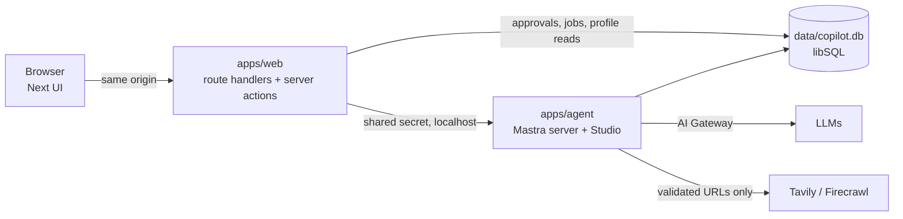

# Implementation Plan — Job Research Copilot

Source of intent: [project-brief.md](../project-brief.md). This file is the milestone plan; each milestone ends in a working, verified, committed state. Update the status column as work lands.

## Decisions (agreed 2026-11-03)

| Area | Choice | Why |
| --- | --- | --- |
| Topology | Separate Mastra server (`apps/agent`, `mastra dev`, :4111) + Next.js UI (`apps/web`, :3000) | Runs live outside Next requests; Studio + `mastra api` CLI give a verification loop |
| Web → agent | Next route handlers / server actions proxy to Mastra; browser never talks to :4111 | Keys stay server-side, one origin, ownership checks in one place |
| Database | libSQL file (`data/copilot.db`): Mastra storage + app tables (Drizzle, `app_*` prefix) | Zero setup, local prototype; Turso later if ever deployed |
| Approvals | DB-backed proposals: `propose_*` tools write a pending row bound to payload hash + version; UI approves; app code applies idempotently | Survives compaction/restarts, approvable later, model can't self-approve |
| Models | Vercel AI Gateway via Mastra model router. Main: Sonnet 5.5; cheap tasks (observational memory, titles, judges): Haiku 5.5. Env-configurable | Reuse Gateway; exact IDs verified against the provider registry in M1 |
| Web providers | Tavily (search/extract) + Firecrawl (scrape, optional hosted browser). Final split decided by the M3 spike | Minimal stack |
| Agent instructions | `AGENTS.md` only (Claude Code reads it natively) | One file for all coding agents |
| Observability | Mastra native tracing to storage (Studio). No Langfuse | Brief: add platforms only for a concrete gap |
| Compaction | Mastra Observational Memory, thread scope | Native mechanism; no cross-session summaries |
| Session-local context | Thread-scoped working memory (no approval needed) | Idiomatic; global profile stays in app tables |
| Global profile | App-owned versioned tables, injected per turn from DB | Approval + audit history; never sourced from a summary |
| Auth boundary | Single local user, servers bound to 127.0.0.1, shared secret web→agent | Brief allows single-user local mode |

## Stack (latest at planning time — re-verify at install)

pnpm 12 workspaces + Turborepo · TypeScript (try 7.x, fall back to 6.x if Next/Mastra tooling breaks) · Biome 2 (lint + format) · Vitest · Playwright · Next.js 16 App Router · Tailwind 4 · shadcn/ui + AI Elements (Radix) · AI SDK 7 `useChat` · `@mastra/core`, `@mastra/memory`, `@mastra/libsql`, `@mastra/ai-sdk`, `@mastra/observability`, `@mastra/evals` · Drizzle · Zod 4.

## Architecture



Repo layout:

```
apps/web        Next.js UI, API proxy, approval actions
apps/agent      Mastra: agents, tools, memory, durable runs, scorers
packages/shared Zod schemas + types (jobs, evidence, approvals, events)
packages/db     Drizzle schema, migrations, data-access functions (no raw SQL from tools)
fixtures/       synthetic listings/pages + saved public examples (offline evals)
docs/           plan, spikes, decisions
```

## Verification loops

| Loop | Command / mechanism | When |
| --- | --- | --- |
| Format/lint on edit | Claude `PostToolUse` hook → `biome check --write <file>` | Every edit |
| Static checks | `pnpm check` = typecheck + lint + unit tests (Turbo-cached) | Before every commit; Claude `Stop` hook if fast enough (<30s) |
| Agent behaviour | `mastra api agent run …` then `mastra api trace list/get` | After agent/tool changes |
| UI | next-devtools MCP (errors/routes), built-in browser / Playwright MCP for screenshots | After UI changes |
| E2E | `pnpm e2e` — Playwright against dev servers with `LLM_MODE=mock` (AI SDK mock model, deterministic, free) | Per milestone |
| Evals | `pnpm eval` offline fixtures (deterministic + LLM-judge scorers); `pnpm smoke:live` real providers, costs money, on demand | M4 onward |
| Git | Small commits after every verified step; pre-commit runs `biome check --staged` | Always |

Live-integration claims are only made when `smoke:live` actually ran; results recorded in `docs/verification.md`.

## Milestones

Each milestone adds its own deterministic tests and eval fixtures; M9 completes the suite.

### M0 — Repo hygiene & Claude setup ✅ (2026-11-03)
- [x] Remove committed Langfuse key from all history; stale worktrees/branches deleted, objects purged. **You:** rotate the key in Langfuse.
- [x] `.mcp.json`: next-devtools, playwright, chrome-devtools, firecrawl, tavily (both OAuth, no keys in config). Mastra docs MCP skipped: Mastra recommends the skill instead.
- [x] `.claude/settings.local.json` untracked + gitignored; stale MCP entries removed.
- [x] `AGENTS.md` filled and read natively by Claude Code (no `CLAUDE.md`, which would stop it loading).
- [x] Official skills installed: ai-sdk, next-dev-loop, vercel-react-best-practices, shadcn, turborepo (+ mastra).
- [x] Project permissions allowlist; `.env*` reads denied. Hooks (`PostToolUse` format, `Stop` check) are wired in M1 once the scripts exist.

### M1 — Monorepo skeleton + streaming hello agent
- pnpm workspace, Turbo, shared tsconfig, Biome, Vitest, Playwright.
- `apps/agent`: Mastra instance, libSQL storage (absolute path), PinoLogger, tracing to storage, env validation (Zod, fails fast with a readable message), `copilot` agent, AI SDK chat route, mock-model switch.
- `apps/web`: Next 16, Tailwind, shadcn + AI Elements, one chat page streaming via proxy route.
- `packages/shared`, `packages/db` (Drizzle + migration command), placeholder-only `.env.example`.
- Claude hooks: `PostToolUse` → Biome on edited file; `Stop` → `pnpm check` if under ~30s. Pre-commit `biome check --staged`.
- **You provide:** `AI_GATEWAY_API_KEY`.
- **Done when:** `pnpm dev` starts both; real streamed reply in UI; trace visible in Studio and via `mastra api trace list`; `pnpm check` + `pnpm e2e` (mock) green.

### M2 — Chat sessions
- Threads = Mastra memory threads under one `resourceId`; sidebar, New chat, reopen (history via `toAISdkMessages`), auto titles (cheap model).
- Server-side ownership check on every thread access; web→agent shared secret.
- Small spike: durable agent + `useChat` resume after refresh, to de-risk M7 early (keep if clean, else note findings).
- **Done when:** independent chats reopen correctly; test proves no cross-thread context leak.

### M3 — Listing ingestion (spike + tools)
- Spike script over 3–5 real public LinkedIn URLs: Tavily extract (advanced) vs Firecrawl scrape (+ ATS lookup). Results in `docs/spikes/extraction.md`; choose provider split.
- `ingest_listing` tool: URL or pasted text; URL guard (scheme allowlist, DNS → block private/loopback/link-local, redirect re-checks); login-wall/snippet/incomplete detection; ATS fallback with identity check; ask-to-paste fallback; states which source was read.
- Tables: `jobs` (dedupe by LinkedIn job id / canonical URL / normalized company+title), `sources` (bounded snapshot, provenance, retrieved_at).
- **You provide:** `TAVILY_API_KEY`, `FIRECRAWL_API_KEY`.
- **Done when:** URL and pasted text both work; login-wall fixture yields honest fallback; unit tests for URL guard, dedupe, wall detection.

### M4 — Vertical slice: assessment → draft → approved snapshot
- Assessment shape in `packages/shared` (overview, strengths/weaknesses, hard conflicts vs soft tradeoffs, unknowns, evidence refs with evidence class, recruiter questions, qualified recommendation; no numeric score).
- `save_job_draft` (automatic, versioned draft), `propose_job_snapshot` → `approvals` row (payload hash, draft version, thread id, idempotency key).
- Approval card in chat (status read from DB); approve/reject server action validates thread, pending status, hash/version freshness; duplicate or retried submissions return the same result.
- Jobs list + detail (draft vs approved versions).
- **Done when:** brief example steps 1–2, 8–9 work end-to-end; state-machine tests cover stale, cross-session, duplicate, lost-response retry.

### M5 — Profile memory, local context, comparisons
- `profile_facts` (kind: hard requirement / soft preference / background; versioned, supersedes, audit). `propose_profile_change` (exact add/modify/remove diff) → approval. Profile injected each turn from DB with its version id.
- Thread-scoped working memory for local assumptions/exceptions; instructions distinguish "for this chat" vs "remember", hypotheticals change nothing.
- Profile page: view; edits create proposals.
- Assessments record profile version; stale flag when it differs.
- `find_saved_jobs` (SQLite FTS on company/title/summary) + `get_job`; agent asks when a reference is ambiguous.
- **Done when:** brief steps 5–7 work; new chat sees approved profile but not prior local assumptions; comparison flags stale assessments.

### M6 — Deep research + real progress
- Tools: `web_search`, `extract_page` (URL guard), source persistence, claims with evidence class (official / independent / anonymous / inference / unknown-conflicting) and publication vs event dates.
- Research as a subagent with topic-scoped instructions; progress via custom data parts emitted by tools (no extra LLM calls).
- Budgets: per-run max tool calls, elapsed time, estimated spend; reserve-before-call wrapper; `budget_limited` event.
- UI: progress timeline, evidence panel with source links and class badges.
- Optional: Firecrawl hosted browser only if the spike showed extraction gaps.
- **Done when:** brief steps 3–4 work with cited sources; budget exhaustion fixture stops cleanly with partial results.

### M7 — Durability: reconnect, stop, compaction
- Durable agent (`createDurableAgent`, beta) for chat runs; active run id persisted per thread; UI resumes via `observe(runId)` after refresh.
- Stop research: abort in-flight work, mark run cancelled, keep partial results, list charges that may still occur.
- Observational Memory (thread scope, Haiku) for compaction; compaction event recorded for the technical panel; pending approvals and profile unaffected (they live in DB).
- Bounded retries with backoff on provider calls.
- **Done when:** refresh mid-research reconnects; stop works; forced-low-budget test compacts and still knows pending approvals + preferences.

### M8 — Technical panel & usage accounting
- `runs` + `run_events` tables; per-run and per-session totals.
- Panel: run id, Studio trace link, model/provider, tool calls grouped (LLM / search / extraction / browser) with status, duration, sanitized args/results, queries + URLs, tokens (input/output/cached/reasoning when exposed), estimated LLM cost vs external-service cost (static price table, labelled estimate), TTFT, total duration, retries, errors, approval and compaction events.
- Sensitive-field redaction in traces; tool output size limits.
- **Done when:** panel numbers match Studio traces for a sample run without double counting.

### M9 — Security pass, eval suite, docs
- Prompt-injection fixtures (memory change, credential reveal, approval bypass); SSRF/redirect tests; confirm web content can never create an approved state.
- 15–20 scenarios from the brief: deterministic Vitest checks + Mastra datasets/experiments with LLM-judge scorers (judge model/version reported, trace ids linked).
- `docs/verification.md`: offline vs live results, latency, usage, cost.
- README (setup, keys, commands, architecture, limitations, tested integrations) + `docs/lessons.md`.

## Simplifications chosen (tell me if any is unacceptable)

1. **Reconnect across agent-server restarts** would need Redis (shared event cache). Plan: in-process cache — browser refresh/reconnect works; after a server restart the run is marked interrupted with partial results kept, and you re-ask. Redis can be added later without redesign.
2. **Hosted browser** is optional (M6), only if extraction APIs prove insufficient.
3. **Saved-job retrieval** uses SQLite full-text search, not embeddings.
4. **External-service cost** is estimated from a static per-call price table (providers don't return cost); LLM cost from Mastra's estimates. Monetary budgets are therefore soft caps.
5. **Durable agents are beta** in Mastra; if they block us, fall back to a regular agent plus our own `run_events` persistence for replay.

## Risks to verify early
- TypeScript 7 compatibility with Next 16 / Mastra CLI (M1).
- Durable agent + AI SDK UI resume interplay (prototype in M2 rather than discovering in M7).
- LinkedIn extraction reliability (M3 spike decides; pasted text is always supported).
