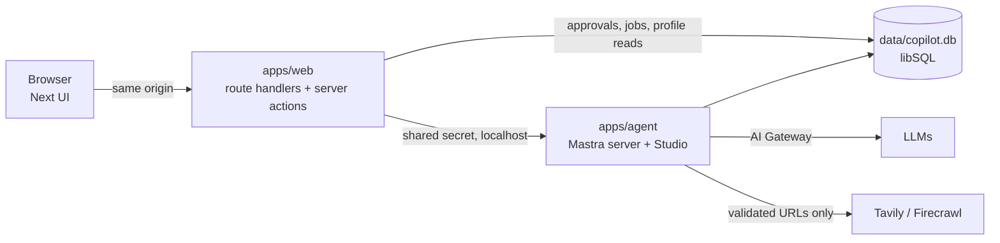

# Implementation Plan — Job Research Copilot

Source of intent: [project-brief.md](../project-brief.md). This file is the milestone plan; each milestone ends in a working, verified, committed state. Update the status column as work lands.

## Decisions (agreed 2026-11-03)

| Area | Choice | Why |
| --- | --- | --- |
| Topology | Separate Mastra server (`apps/agent`, `mastra dev`, :4111) + Next.js UI (`apps/web`, :3000) | Runs live outside Next requests; Studio + `mastra api` CLI give a verification loop |
| Web → agent | Next route handlers / server actions proxy to Mastra; browser never talks to :4111 | Keys stay server-side, one origin, ownership checks in one place |
| Database | libSQL file (`data/copilot.db`): Mastra storage + app tables (Drizzle, `app_*` prefix) | Zero setup, local prototype; Turso later if ever deployed |
| Approvals | DB-backed proposals: `propose_profile_change` writes a pending row bound to payload hash + version; UI approves; app code applies idempotently. Changed 2026-11-04: job assessments and the user's own `/profile` edits need no approval (see M12) | Survives compaction/restarts, approvable later, model can't self-approve |
| Models | Vercel AI Gateway via the native `@ai-sdk/gateway` provider instance (not Mastra's `vercel/` router string, which uses Gateway's OpenAI-compatible endpoint and can drop cache/reasoning usage). Main `anthropic/claude-sonnet-5.5`, fast `anthropic/claude-haiku-5.5`; env-configurable; `LLM_MODE=mock` for a deterministic fake | Reuse Gateway with full usage data |
| Web providers | Tavily (search/extract) + Firecrawl (scrape, optional hosted browser). Final split decided by the M3 spike | Minimal stack |
| Chat UI | shadcn/ui native chat components (MessageScroller, Message, Bubble), Radix base; AI Elements added per component only where it adds value | shadcn guidance; fewer dependencies |
| Agent instructions | `AGENTS.md` only (Claude Code reads it natively) | One file for all coding agents |
| Observability | Mastra native tracing, logs and metrics to a DuckDB store (`data/copilot.duckdb`, Studio). No Langfuse | Brief: add platforms only for a concrete gap |
| Compaction | Mastra Observational Memory, thread scope | Native mechanism; no cross-session summaries |
| Session-local context | Thread-scoped working memory (no approval needed) | Idiomatic; global profile stays in app tables |
| Global profile | App-owned versioned tables, injected per turn from DB | Approval + audit history; never sourced from a summary |
| Auth boundary | Single local user, servers bound to 127.0.0.1, shared secret web→agent | Brief allows single-user local mode |

## Stack

pnpm enforces a 24h minimum release age: pin to the newest version older than that; never accept the `minimumReleaseAgeExclude` entries pnpm auto-adds.

pnpm 12 workspaces + Turborepo · TypeScript 6.0 (7.x is native-only with no JS API, which Next needs) · Biome 2 (lint + format) · Vitest 5 · Playwright (system Chrome) · Next.js 16.4 App Router (Cache Components on) · Tailwind 4 · shadcn/ui (Radix Nova) · AI SDK 7 `useChat` · `@mastra/core`, `@mastra/memory`, `@mastra/libsql`, `@mastra/ai-sdk`, `@mastra/observability`, `@mastra/evals` · Drizzle · Zod 4.

## Architecture



Repo layout:

```
apps/web        Next.js UI, API proxy, approval actions
apps/agent      Mastra: agents, tools, memory, durable runs, scorers
packages/shared Zod schemas + types (jobs, evidence, approvals, events)
packages/db     Drizzle schema, migrations, data-access functions (no raw SQL from tools)
fixtures/       synthetic listings/pages + saved public examples (offline evals)
docs/           plan, spikes, decisions
```

## Verification loops

| Loop | Command / mechanism | When |
| --- | --- | --- |
| Format/lint on edit | Claude `PostToolUse` hook → `biome check --write <file>` | Every edit |
| Static checks | `pnpm check` = Biome + typecheck + unit tests (Turbo-cached) | Git pre-commit hook; Claude `Stop` hook (blocks once, feeds errors back) |
| Agent behaviour | `pnpm agent:api agent run copilot '{"messages":"…"}'`, `pnpm agent:api trace list` (wraps `mastra api` with the shared secret) | After agent/tool changes |
| UI | next-devtools MCP (errors/routes), built-in browser / Playwright MCP for screenshots | After UI changes |
| E2E | `pnpm e2e` — Playwright starts its own stack (agent :4112, web :3001 in the main checkout, `scripts/ports.sh` slot in a worktree; `data/e2e.db`, mock model). Stop `pnpm dev` first: Mastra allows one `mastra dev` per checkout | Per milestone |
| Evals | `pnpm eval` offline fixtures (deterministic + LLM-judge scorers); `pnpm smoke:live` real providers, costs money, on demand | M4 onward |
| Git | Small commits after every verified step; pre-commit runs `pnpm check` | Always |

Live-integration claims are only made when `smoke:live` actually ran; results recorded in `docs/verification.md`.

## Milestones

Each milestone adds its own deterministic tests and eval fixtures; M9 completes the suite.

### M0 — Repo hygiene & Claude setup ✅ (2026-11-03)
- [x] Remove committed Langfuse key from all history; stale worktrees/branches deleted, objects purged. **You:** rotate the key in Langfuse.
- [x] `.mcp.json`: next-devtools, playwright, chrome-devtools, firecrawl, tavily (both OAuth, no keys in config). Mastra docs MCP skipped: Mastra recommends the skill instead.
- [x] `.claude/settings.local.json` untracked + gitignored; stale MCP entries removed.
- [x] `AGENTS.md` filled and read natively by Claude Code (no `CLAUDE.md`, which would stop it loading).
- [x] Official skills installed: ai-sdk, next-dev-loop, vercel-react-best-practices, shadcn, turborepo (+ mastra).
- [x] Project permissions allowlist; `.env*` reads denied. Hooks (`PostToolUse` format, `Stop` check) are wired in M1 once the scripts exist.

### M1 — Monorepo skeleton + streaming hello agent ✅ (2026-11-03)
- [x] pnpm workspace, Turbo, shared tsconfig, Biome, Vitest, Playwright.
- [x] `apps/agent`: Mastra on 127.0.0.1:4111, SimpleAuth shared secret, libSQL storage, PinoLogger, tracing to storage, Zod env validation, `copilot` agent, `chatRoute` (AI SDK v7), mock model.
- [x] `apps/web`: Next 16.4, Tailwind, shadcn chat components, chat page streaming via `/api/chat` proxy.
- [x] `packages/shared`, `packages/db` (Drizzle + migrations, `app_users`), `.env.example`, `pnpm setup:env`.
- [x] Hooks: Claude `PostToolUse` Biome format, `Stop` → `pnpm check`; git pre-commit → `pnpm check`.
- [x] Verified (mock): browser → proxy → agent stream; 401 without secret; traces via `pnpm agent:api trace list`; `pnpm check` + `pnpm e2e` green.
- [x] Live: real Sonnet 5.5 reply streamed in the UI; trace and usage verified ([verification.md](verification.md)).
- [x] Stream errors reach the client only as a sanitized summary (`chatRoute` `onError`).
- Deferred: Mastra metrics/cost dashboard needs a DuckDB observability store (M8). `chatRoute` aborts generation on client disconnect; durable runs replace it in M7.

### M2 — Chat sessions ✅ (2026-11-03)
- [x] Threads = Mastra memory threads under one resource (`chatMemory`: last 20 messages, no semantic recall or resource working memory). Chat at `/c/<threadId>`; `/` redirects to a fresh id; the agent creates the thread on the first message.
- [x] Sidebar (list, New chat, reopen, rename, delete), history via `/threads/:id/ui-messages` (`toAISdkMessages` v7), auto titles with the fast model (`generateTitle`, streamed `data-thread-title`).
- [x] Ownership: `SimpleAuth` `mapUserToResourceId` pins every memory call to the local resource (Mastra filters lists, 403s foreign threads, rejects mismatched `/chat`). The `/api/chat` proxy accepts only `{ threadId, message }` and builds the agent body itself.
- [x] Spike: durable agent resume works on the Mastra side; `chatRoute` can't be reused for it ([spikes/durable-resume.md](spikes/durable-resume.md)).
- [x] Verified (mock): unit tests for recall, no cross-thread leak, resource mismatch, history scoping, proxy body; e2e for separate histories, reopen after reload, rename/delete, foreign threads hidden and inaccessible.

### M3 — Listing ingestion ✅ (2026-11-03)
- [x] Spike on 5 live LinkedIn URLs ([spikes/extraction.md](spikes/extraction.md)): Tavily extract `basic` reads full guest pages (advanced as retry); Firecrawl refuses LinkedIn (kept as second extractor for other pages); ATS search needs an identity check.
- [x] `ingest_listing`: URL or pasted text (read from the latest user message, not copied by the model); URL guard incl. DNS and final-URL re-check; sign-in/search/truncated detection; ATS fallback with identity check; ask-to-paste fallback; result names the source actually read. Overview: [apps/agent/src/ingest/AGENTS.md](../apps/agent/src/ingest/AGENTS.md).
- [x] Tables `app_jobs` (dedupe: LinkedIn id → canonical URL → normalized company+title without conflicting ids) and `app_sources` (bounded snapshot, provider, URL, thread, retrieved_at; idempotent per job+content).
- [x] UI: Markdown replies (Streamdown, no images/HTML), tool Trace rows.
- [x] Saved-job check before fetching: a URL of a saved job returns `already_saved` (no scraping, no re-assessment); `refresh: true` re-reads on request.
- [x] Verified: unit tests (guard, parser, dedupe, orchestrator with fixtures), offline e2e for fallback/blocked/pasted paths, live runs ([verification.md](verification.md)).

### M4 — Vertical slice: assessment → draft → approved snapshot ✅ (2026-11-03)
- [x] Assessment shape (`packages/shared/src/assessment.ts`): overview, `fitBasis` (role only vs with profile), strengths/weaknesses, hard conflicts vs soft tradeoffs, unknowns, recruiter questions, qualified recommendation; evidence class + source ids per point; no numeric score. Later: one-line `headline` and a coarse 5-level `fitLevel` (only with the profile), shown as verdict badge, fit meter and signal counts. Optional `salary` (pay as the listing states it; every figure must appear in the job's sources), shown in the job list, job page and chat card.
- [x] `save_job_draft` (automatic, versioned, sources must belong to the job) and `propose_job_snapshot` → `app_approvals` (payload hash, draft version, thread id, idempotency key). State machine: [packages/db/AGENTS.md](../packages/db/AGENTS.md).
- [x] Approval card in chat (state from DB, decision with displayed payload hash); jobs list + detail with draft vs approved versions and sources read.
- [x] Verified: db tests for stale (newer draft, changed hash), cross-chat, duplicate, lost-response retry, concurrent approve, superseded, versioning; offline e2e of paste → draft → propose → approve → jobs pages; live run of steps 1–2 and 8–9 ([verification.md](verification.md)).
- The agent sees approval outcomes through the per-turn profile (M5) and `get_job`; pending snapshot approvals of other chats are not injected.

### M5 — Profile memory, local context, comparisons ✅ (2026-11-03)
- [x] `app_profile_facts` (hard requirement / soft preference / background) + `app_profile_versions`; facts are superseded, never overwritten. `propose_profile_change` (exact add/modify/remove diff with the text before) → approval bound to the base version; stale if the profile moved. State machine: [packages/db/AGENTS.md](../packages/db/AGENTS.md).
- [x] Approved profile injected every turn from the DB (async `instructions`, with version and fact ids); never from summaries.
- [x] Thread-scoped working memory for "for this chat" notes; instructions separate local / remember / hypothetical; drafts (shared by all chats) are written against the approved profile only.
- [x] `/profile`: current facts, edits and additions become proposals approved on the page, history with diffs.
- [x] Drafts record the profile version (set by app code); jobs list/detail and `get_job` flag assessments made under an older profile.
- [x] Re-assess after a profile change: `get_job` with `includeListing: true` returns the stored listing, so the agent re-scores without the user sharing it again.
- [x] Batch re-score: "Re-score" on `/jobs` → `rescore_jobs` in a new chat (one structured call per stale job, max 25) → "Approve all" for exactly the drafts shown ([apps/agent/src/rescore/AGENTS.md](../apps/agent/src/rescore/AGENTS.md)).
- [x] `find_saved_jobs` (FTS5, quoted prefix terms, AND then OR) + `get_job`.
- [x] Verified: db tests (diffs, supersede, stale base, idempotency, wrong chat, reject, draft profile version, search), working-memory isolation test, e2e for remember → approve → new chat sees it while local notes stay local, profile page approvals, stale flag; live runs ([verification.md](verification.md)).

### M6 — Deep research + real progress ✅ (2026-11-03)
- [x] `research_company` → researcher agent with per-run `web_search`, `extract_page` (URL guard, stored as `web` source), `record_claim` (`app_claims`: evidence class, cited sources, publication vs event date). Overview: [apps/agent/src/research/AGENTS.md](../apps/agent/src/research/AGENTS.md).
- [x] Budget: per-run tool calls, elapsed time, estimated spend (static price table, labelled); reserve-before-call; abort on limit; `budget_limited` / `cancelled` keep partial claims.
- [x] Progress as persisted `data-research-progress` parts (no extra LLM calls); UI timeline + findings panel (topic, evidence badge, dates, source links, web calls/duration/est. cost); job page "Research evidence".
- [x] `WEB_MODE=fixture` (synthetic pages incl. an injection attempt) for offline e2e/evals.
- [x] Replaced `chatRoute` with a validated `/chat` route (`handleChatStream` + chunk sanitizer for tool arguments that aren't valid JSON); copilot `maxOutputTokens` 16k.
- Hosted browser not added: Tavily extraction covered the live research run.
- [x] Verified: budget/run unit tests (completed, budget exhausted, cancelled), offline e2e of a research run with reload, live research run on Dwelly ([verification.md](verification.md)).

### M7 — Durability: reconnect, stop, compaction ✅ (2026-11-03)
- [x] Chat runs use the durable copilot (`createDurableAgent`); `app_runs` maps a thread to its active run (one at a time, else 409). `GET /chat/:threadId/stream` re-observes it for `useChat({ resume: true })`; `POST /chat/:threadId/stop` → `abortRunStream`. Runs left `running` by a previous process are marked `interrupted` at startup (replay cache is in-process: simplification 1).
- [x] Stop: ends the run on the server (research included), stops new provider calls, keeps claims already recorded.
- [x] Observational Memory (thread scope, fast model) replaces the fixed message window; raw messages stay in storage; the Observer is told not to copy the profile or approval statuses. Profile and this chat's pending approvals are injected from the DB every turn. Compaction events render in chat (technical panel: M8).
- [x] Bounded retries (2, exponential backoff) on network errors, timeouts, 429 and 5xx for Tavily/Firecrawl; research shows retries in its timeline.
- [x] Verified: unit tests (runs, compaction at a forced-low threshold keeps profile + pending approval, retries), e2e (refresh mid-reply reconnects and history has one reply, Stop → cancelled and reply stays cut, second message → 409), live runs ([verification.md](verification.md)).

### M8 — Technical panel & usage accounting ✅ (2026-11-03)
- [x] `app_runs` (model, trace id, time to first text, duration) + `app_run_events` (one row per model call / provider call, plus tools, retries, compaction, errors); run and chat totals are sums. Overview: [apps/agent/src/usage/AGENTS.md](../apps/agent/src/usage/AGENTS.md).
- [x] Panel ("Technical details" sheet per chat): run id, status, Studio trace link, model/provider/framework, LLM / search / extraction / browser / tools tables with status, duration, sanitized args/results, queries and URLs, tokens incl. cached and reasoning, estimated LLM vs external cost (labelled), retries, errors, compaction and approval events.
- [x] Redaction: trace `SensitiveDataFilter` extended (cookies, `*_token`); event details sanitized and size-limited. Tool outputs were already bounded (listing 20k, page 12k chars).
- [x] Verified: live turns match the Studio trace one-to-one per `model_step` (copilot, researcher, observer, title) with equal tokens; unit tests for totals, recorder, prices, sanitizer, redaction, metered model; e2e checks the panel after a research run.
- [x] DuckDB observability store: Studio traces (with token/cost columns), logs and metrics pages work; libSQL keeps memory and app tables.

### M9 — Security pass, eval suite, docs
- Prompt-injection fixtures (memory change, credential reveal, approval bypass); SSRF/redirect tests; confirm web content can never create an approved state.
- [x] Scorers registered in Studio; live scoring on copilot turns (code checks always, LLM judge on 10%); `pnpm eval`: 12 behaviour cases as Mastra datasets/experiments on fixtures with code gates + `openai/gpt-6.1-sol` judges, own eval DB, report with judge model; traces via `pnpm eval:studio` ([apps/agent/src/evals/AGENTS.md](../apps/agent/src/evals/AGENTS.md)).
- [x] Multi-chat scenarios as live evals (`scenarios.eval.ts`): memory across chats without leakage, compaction keeps the approved profile and pending approvals, comparisons with stale assessments. Deterministic Vitest covers the same mechanics offline (`memory.test.ts`, `compaction.test.ts`).
- `docs/verification.md`: offline vs live results, latency, usage, cost.
- [x] README (setup, keys, commands, limitations) + [docs/architecture.md](architecture.md) (mermaid walkthrough).
- [ ] `docs/lessons.md`.

### M10 — Job tracking (simple CRM) + learning preferences early
- [x] `app_jobs.status` (`new → shortlisted → applied → interviewing → offer`, `rejected`, `dismissed`) with `status_changed_at` and `archived_at`; closing statuses archive, reopening unarchives, manual (un)archive keeps the status. Re-score skips archived jobs.
- [x] `/jobs` as a compact table: status tabs with counts (Active, each open status, Archived), FTS search, sort, inline status menu; same menu on the job page.
- [x] `set_job_status` tool (no approval, only on the user's request; the injection eval forbids it); `find_saved_jobs` filters by status.
- [x] While the profile is thin (no hard requirement or < 6 facts), the copilot ends each assessment with 1–2 preference questions that decide that job; answers become profile proposals.
- [x] Verified: db/tool/list unit tests, e2e `jobs.spec.ts` (status, archive, tabs, search, unarchive, job page), browser check on the worktree DB.
- Later if needed: paging (fine at a few hundred rows), bulk actions, notes and dates per job.

### M11 — Research suggestions in the UI
- [x] Assessments name 1–3 `researchTopics` (defaults for older drafts); the chat card and the job page show them as "Research next" buttons. Chat buttons send the request in the same chat; job-page buttons start a new chat (`startResearchAction`, company from the DB) and the copilot loads the job with `get_job`.
- [x] Verified: shared unit tests, e2e `research.spec.ts` (card button, job-page button).

### M12 — Drop job snapshot approvals (2026-11-04)
- [x] Approving drafts added clicks without value: every `save_job_draft` is now the job's current assessment, earlier versions stay as history on the job page. Removed `app_job_snapshots`, `propose_job_snapshot`, the approve buttons and "Approve all" (migration `0010` drops snapshot rows and their approvals). This supersedes the brief's snapshot-approval requirement.
- [x] `/profile` edits apply right away (`editProfile`, checked against the version the page showed). Profile changes the copilot proposes in a chat still need approval (guards against injected memory changes).
- [x] Verified: db tests (history, direct edits, stale edit refused, edit makes an older chat proposal stale), migration on a copy of the dev DB, e2e `assessments.spec.ts` (v1 → v2 with history, no approve controls), updated profile/rescore/listing/research specs.

## Job discovery (agreed 2026-11-10)

Scheduled ingestion from job boards, reported as an inbox plus an email digest. This supersedes the brief's "automatic job discovery" out-of-scope line.

| Area | Choice | Why |
| --- | --- | --- |
| Scheduler | Mastra scheduled workflow `discover-jobs` (`schedule.cron`, state in libSQL, Studio `/workflows/schedules`), twice a day; "Run now" for gaps | Native, traced, no extra service; needs a long-lived process (local `pnpm dev`, later a host) |
| Funnel | Deterministic screen → Haiku triage score (0–100 + reason) → full Sonnet assessment for the top N per run | About $1–2/day instead of $10–20 for assessing everything |
| Criteria | Structured search settings (one JSON row) for the screen and source queries; triage and assessment read the profile facts | Deterministic filters must be predictable and debuggable (reasons are stored) |
| Volume | Postings failing the screen stay in `app_postings` and never become jobs; jobs under the triage threshold are hidden by one predicate | Chat tools, FTS, re-score keep working on jobs worth seeing |
| Dedupe | Posting (source, external id) → off-board apply URL → company key + title; ATS id later | Same job on several boards becomes one job with several postings |
| Sources | Official free feeds read directly (Himalayas, WWR, RemoteOK, Remotive, NoDesk); other boards via pay-per-event Apify actors (LinkedIn, HiringCafe, Welcome to the Jungle, Wellfound, Dice, Built In, YC, Jobgether), started by our workflow with per-run caps and a monthly budget (default $100). No proxy setup: pay-per-event actors include it | Free and sanctioned where a feed exists; maintained scrapers elsewhere; accepted ToS risk for personal use |

### M13 — Discovery foundation (Himalayas direct + LinkedIn via Apify, no LLM)
- [x] `app_postings`, `app_search_settings`, `app_discovery_runs`; `app_jobs` gains `origin`, `company_key`, triage, `kept_at`, `seen_at`; dedupe key uses the company key (backfill).
- [x] Shared search settings, posting schema, `screenPosting` (reasons; permissive: titles never have to match, unknowns pass), `companyKey`.
- [x] Source adapters: Himalayas API and a generic Apify runner with a `valig/linkedin-jobs-scraper` definition (`skipJobId` for known ids, caps, monthly budget check); fixtures (`WEB_MODE=fixture`).
- [x] `discover-jobs` workflow: fetch → postings → screen → jobs + board snapshot → run record; schedule only in the main checkout with `DISCOVERY_SCHEDULE=on`; one run at a time; interrupted sweep at startup; manual "Run now" and 7/30-day backfills (`POST /discovery/run`).
- [x] UI: `/settings/search` (save re-screens), `/discovery` runs with per-source health, cost and what the screen dropped, source badges on jobs.
- [ ] Verified: unit tests, e2e on fixture sources, one live run.

### M14 — Scoring funnel + report
- [ ] Triage agent (fast model, no tools, budgeted), `assessJob` shared with re-score, top-N assessments, usage on a `discovery:<runId>` thread.
- [ ] Resend email digest; "new matches" badge from unseen jobs.
- [ ] Triage evals (match, hard conflict, injection); live scheduled fire.

### M15 — UI for daily volume + companies
- [ ] Paging and tab counts in SQL; New tab as an inbox (score sort, unseen, filters, bulk shortlist/dismiss); "Screened out" tab with reasons and "Keep anyway".
- [ ] Job page triage card, "Assess fully", "Seen on" postings; `app_companies` and a company page.

### M16 — More sources
- [ ] Direct feeds: We Work Remotely, RemoteOK (followed link-back), Remotive (attribution), NoDesk. Apify definitions: HiringCafe, Welcome to the Jungle, Wellfound, Dice, Built In, YC, Jobgether. Per-source match rate, duplicate rate and cost per match.

### M17 — Hosting
- [ ] One long-lived host with a volume (agent + web), real auth, backups; SQLite on the volume or Turso.

### M18 — ATS enrichment
- [ ] Compare the `fantastic-jobs/career-site-job-listing-feed` actor with a hand-built Greenhouse/Lever/Ashby/Workable resolver; `ats_key` as the strongest dedupe key. Skipped boards: TrueUp, Tech Jobs for Good, Arc.dev, JustRemote, PowerToFly, Climatebase, Levels.fyi (no maintained actor), FlexJobs (paid login), AIJobs.net (shut down).

## Simplifications chosen (tell me if any is unacceptable)

1. **Reconnect across agent-server restarts** would need Redis (shared event cache). Plan: in-process cache — browser refresh/reconnect works; after a server restart the run is marked interrupted with partial results kept, and you re-ask. Redis can be added later without redesign.
2. **Hosted browser** is optional (M6), only if extraction APIs prove insufficient.
3. **Saved-job retrieval** uses SQLite full-text search, not embeddings.
4. **External-service cost** is estimated from a static per-call price table (providers don't return cost); LLM cost from Mastra's estimates. Monetary budgets are therefore soft caps.
5. **Durable agents are beta** in Mastra; if they block us, fall back to a regular agent plus our own `run_events` persistence for replay.

## Risks to verify early
- Durable agent + AI SDK UI resume interplay: verified in M7 (e2e and live).
- LinkedIn extraction reliability: Tavily read 5/5 sample listings (M3); layout changes degrade to ATS lookup or paste, never to assessing a partial page.
