# How it works

A walkthrough of the moving parts, with diagrams. Details and rules live in the nearest `AGENTS.md`; this page links to them instead of repeating them.

- [System overview](#system-overview)
- [A chat turn, end to end](#a-chat-turn-end-to-end)
- [The copilot agent](#the-copilot-agent)
- [Tools](#tools)
- [Human-in-the-loop approvals](#human-in-the-loop-approvals)
- [Memory: what the agent knows](#memory-what-the-agent-knows)
- [Listing ingestion](#listing-ingestion)
- [Company research](#company-research)
- [Batch re-score](#batch-re-score)
- [Durable runs: refresh, reconnect, stop](#durable-runs-refresh-reconnect-stop)
- [Data model](#data-model)
- [Safety boundaries](#safety-boundaries)
- [Observability, usage and evals](#observability-usage-and-evals)

## System overview

Two processes on localhost share one SQLite file. The browser only talks to the Next.js app; the Next.js server talks to the Mastra server with a shared secret.

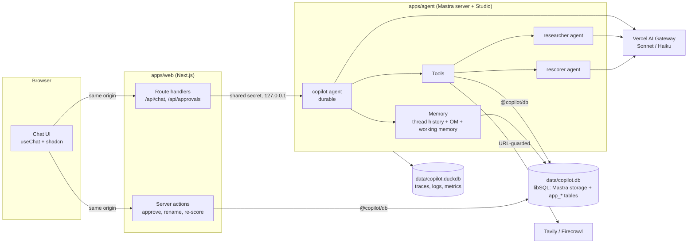

| Package | Role |
| --- | --- |
| `apps/web` | UI, proxy to the agent, and the **only** place approvals are decided ([AGENTS.md](../apps/web/AGENTS.md)) |
| `apps/agent` | Mastra agents, tools, memory, durable chat runs, scorers ([AGENTS.md](../apps/agent/AGENTS.md)) |
| `packages/db` | Drizzle schema, migrations and every data-access function, including the approval state machine ([AGENTS.md](../packages/db/AGENTS.md)) |
| `packages/shared` | Zod schemas shared by both apps (assessment, claims, profile) |

## A chat turn, end to end

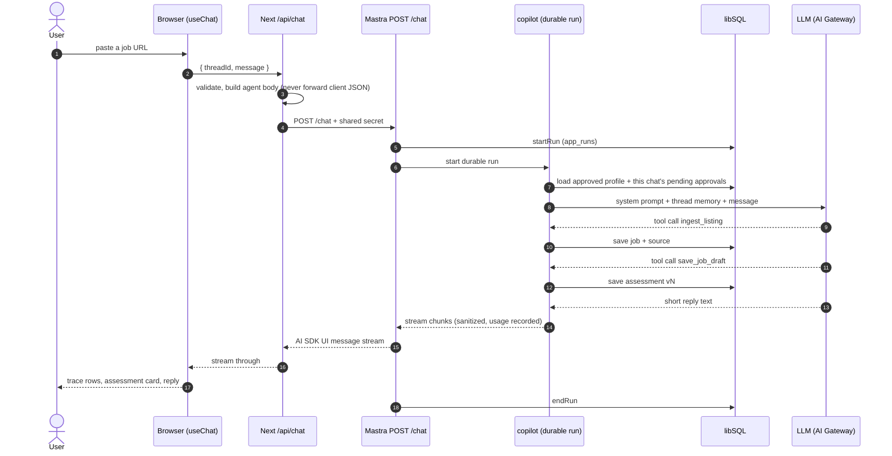

The system prompt is rebuilt every turn from the database: fixed rules, the **approved profile** (with version and short fact handles like `f7`), this chat's **pending approvals**, and today's date last so the cached prefix stays stable (`buildInstructions` in [copilot.ts](../apps/agent/src/mastra/agents/copilot.ts)).

## The copilot agent

The copilot is an open-ended conversational agent, not a wizard. It decides which tools to call; app code decides what those tools are allowed to do.

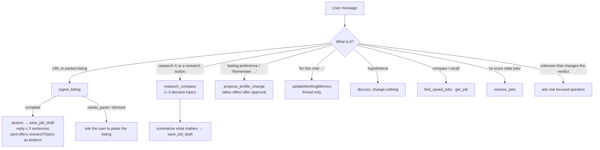

Key behaviours, all from the prompt in [copilot.ts](../apps/agent/src/mastra/agents/copilot.ts) and [assessment-rules.ts](../apps/agent/src/mastra/agents/assessment-rules.ts):

- **Role vs fit.** Without a profile, an assessment is `role_only`; with one, it is `with_profile` and personal fit points must be `inference` citing current profile facts by handle.
- **Evidence classes.** Every point is `official`, `independent`, `anonymous`, `inference` or `unknown_conflicting`. Sourced classes must cite sources of the same job (checked in `@copilot/db`, not by the model).
- **Research on request.** Each assessment names 1–3 `researchTopics`; the chat card and the job page show them as "Research next" buttons that send a request naming the job id (`researchRequestText`). The copilot never researches by default.
- **No approval for assessments.** Every `save_job_draft` is the job's new current version; earlier versions stay as history.
- **Never claims success early.** Profile changes are "proposed" until the user approves them.

Models come from the AI Gateway: `main` (Sonnet) for the copilot, researcher and rescorer, `fast` (Haiku) for compaction and chat titles. `LLM_MODE=mock` swaps in a deterministic fake for tests and offline dev ([models.ts](../apps/agent/src/mastra/models.ts)).

## Tools

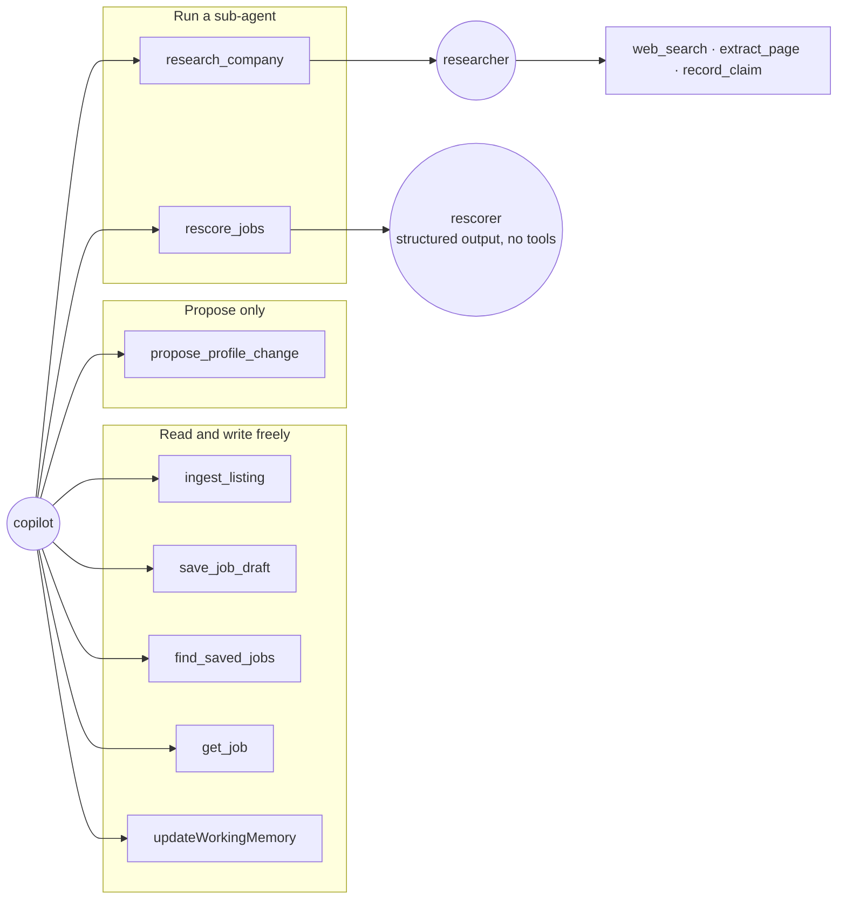

| Tool | Does | Writes |
| --- | --- | --- |
| `ingest_listing` | Reads a URL (via providers) or the pasted text from the latest user message | `app_jobs`, `app_sources` |
| `save_job_draft` | Saves the assessment as the job's new current version (no approval needed) | `app_job_drafts` |
| `propose_profile_change` | Creates a **pending** approval with exact add/modify/remove changes | `app_approvals` |
| `find_saved_jobs`, `get_job` | Full-text search and job detail; `includeListing` re-reads the stored listing | — |
| `research_company` | Runs the researcher under a budget, streams progress | `app_sources`, `app_claims` |
| `rescore_jobs` | Re-assesses stale jobs against the current profile, 3 at a time | `app_job_drafts` |
| `updateWorkingMemory` | Mastra built-in: "this chat only" notes | Mastra thread |

Rule violations raised by `@copilot/db` come back as `{ ok: false, error }` so the model can correct itself and retry.

## Human-in-the-loop approvals

Only profile changes the copilot proposes need approval. Approvals are **database rows, not paused agent runs**. `propose_profile_change` writes a pending row bound to a payload hash and a version; the user approves later in the UI; app code applies the change. This survives restarts and compaction, and the model has no tool that can approve anything.

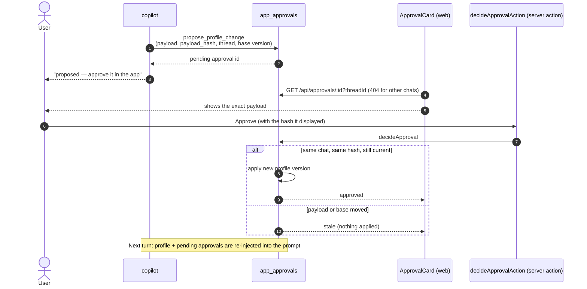

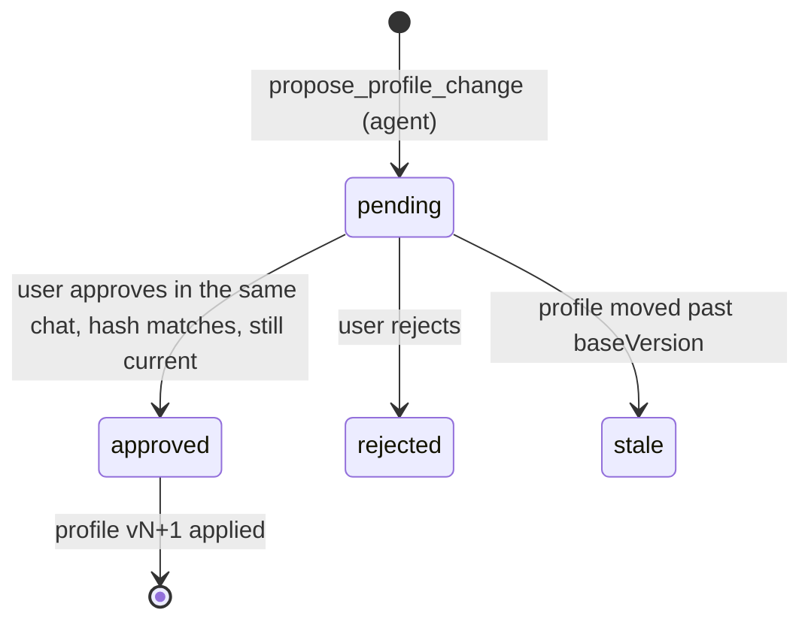

What needs approval and what doesn't:

| Change | Approval? | Where it lives |
| --- | --- | --- |
| Job assessment | No, saved automatically; the latest version is current, earlier ones are history | `app_job_drafts` ("Saved · vN") |
| Profile change proposed in a chat | **Yes** | `app_profile_versions`, `app_profile_facts` |
| Profile edit on `/profile` (the user's own) | No, applies right away as a new version (recorded as an approved change) | same |
| "For this chat" assumption | No | Thread working memory |
| Research claims | No | `app_claims` |

Exact rules: [packages/db/AGENTS.md](../packages/db/AGENTS.md#profile-change-approvals).

## Memory: what the agent knows

Three layers, deliberately separated so that a chat can never "remember" something the user didn't approve, and chats never see each other.

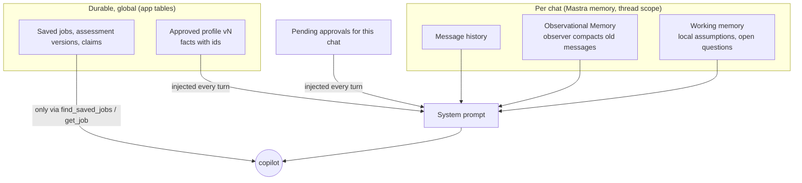

- **No semantic recall, nothing resource-scoped.** Only the current thread is recalled ([memory.ts](../apps/agent/src/mastra/memory.ts)).
- **Compaction.** Once unobserved history passes `OM_MESSAGE_TOKENS` (default 30k), the Observer (fast model) turns older messages into an observation log; raw messages stay in storage. The chat shows a compaction line. The observer is told not to copy profile or approval state, since those are re-injected fresh.
- **Profile is never sourced from a summary or a web page**, only from approved rows.

## Listing ingestion

The server never fetches listing URLs itself; providers do, and every URL passes the URL guard (public http(s) only, re-checked on the provider's final URL). LinkedIn guest pages often show only a job card, so the tool falls back to the employer's ATS posting or asks for a paste. A URL that already belongs to a saved job (same LinkedIn id, canonical URL or listing snapshot URL) is answered from the database before any provider call; the copilot just says so and re-reads only when asked (`refresh: true`).

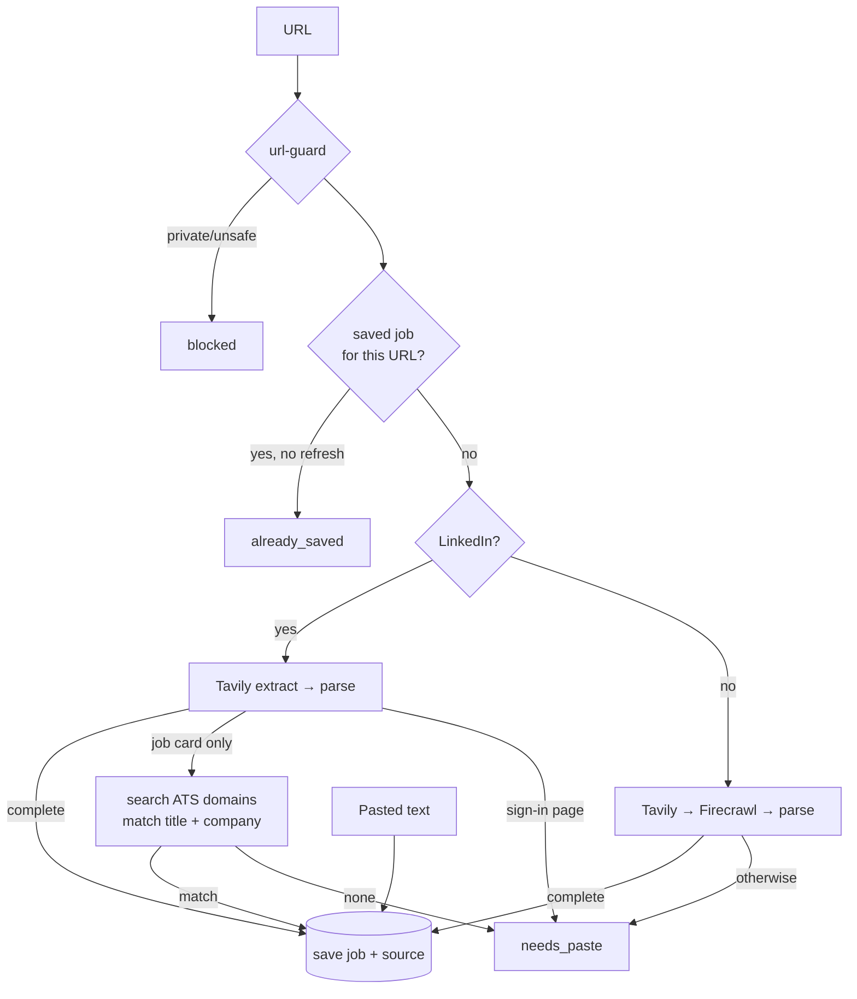

Details: [apps/agent/src/ingest/AGENTS.md](../apps/agent/src/ingest/AGENTS.md).

## Company research

`research_company` runs a separate **researcher** agent from inside the tool (not a Mastra subagent), so app code owns its tools, budget and progress events.

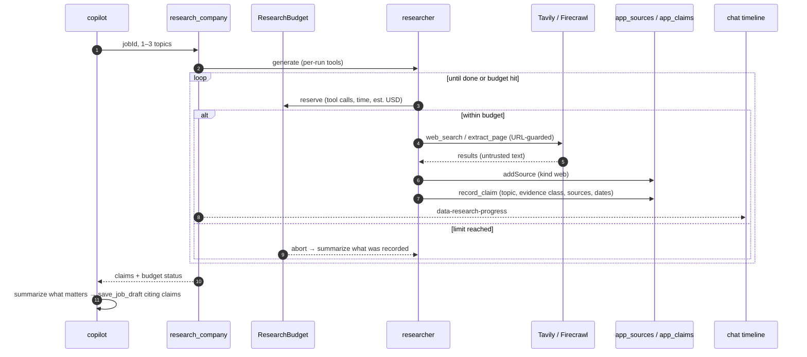

- Default budget: 12 web calls, 2 minutes, ~$0.50 estimated ([budget.ts](../apps/agent/src/research/budget.ts)). Claims are saved as they are found, so a stopped or budget-limited run keeps partial results.
- Page text is wrapped as untrusted; a fixture page contains a prompt injection to test this.

Details: [apps/agent/src/research/AGENTS.md](../apps/agent/src/research/AGENTS.md).

## Batch re-score

After a profile change, earlier assessments are **stale** (they predate the current profile version). The "Re-score" button on `/jobs` starts a new chat that calls `rescore_jobs`.

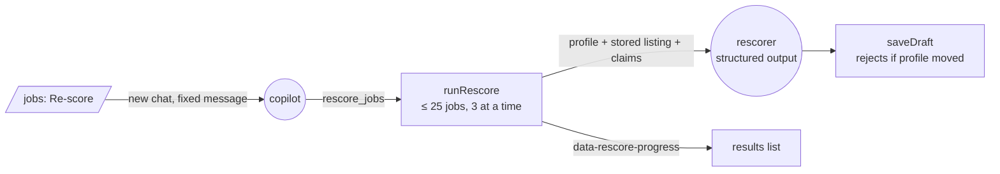

Details: [apps/agent/src/rescore/AGENTS.md](../apps/agent/src/rescore/AGENTS.md).

## Job discovery

A Mastra workflow (`discover-jobs`) fetches new postings from job boards twice a day, plus "Run now" and backfills from `/discovery`. Postings failing a deliberately permissive deterministic screen stay postings; passing ones are deduped into jobs. Each new job then gets a fast-model triage score (0–100 + reason; under the threshold it's hidden), the run's best matches get a full assessment, and the matches are emailed (Resend). Details: [apps/agent/src/discovery/AGENTS.md](../apps/agent/src/discovery/AGENTS.md).

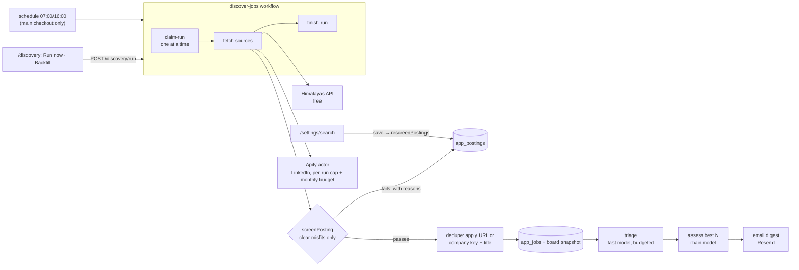

- **Sources:** free official feeds are read directly. Boards without one use pay-per-event Apify actors, which include their proxies.
- **Cost control:** runs are started by our code, with per-run caps and a 30-day budget check. Spend is recorded per source and run.
- **Hidden jobs:** discovered jobs hidden by the screen (or, later, the triage threshold) are filtered by `visibleJobs` in `listJobs`. Chat tools and re-score therefore only see jobs worth showing.

## Durable runs: refresh, reconnect, stop

Chat runs outlive the HTTP request. Closing the tab or refreshing never stops a run; Stop does.

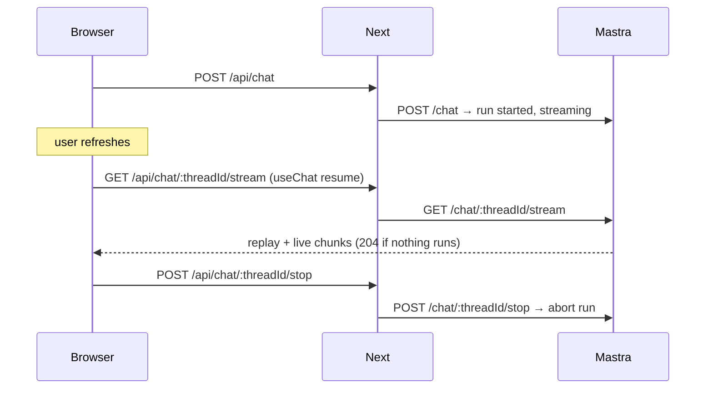

Runs are recorded in `app_runs`; runs left over from a crashed process are marked interrupted at startup. Several chats can run at once (one run per chat); the sidebar polls `GET /api/run-status` to show a spinner on running chats and a dot on replies not opened yet. Background: [docs/spikes/durable-resume.md](spikes/durable-resume.md).

## Data model

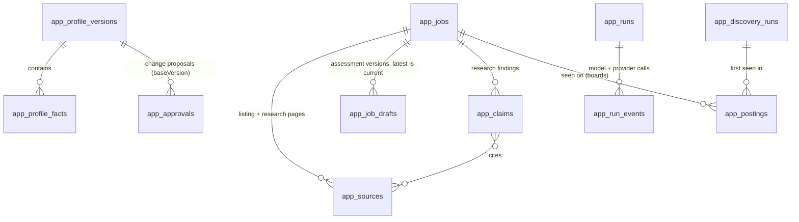

`app_search_settings` is a single JSON row (`SearchSettings`). `app_discovery_runs` keeps per-source results as JSON.

Mastra's own tables (threads, messages, working memory, observations, scores) live in the same libSQL file. Traces, logs and metrics go to DuckDB. Schema: [schema.ts](../packages/db/src/schema.ts).

## Safety boundaries

Deterministic code enforces everything that matters; the model only proposes.

| Concern | Enforced by |
| --- | --- |
| Approvals | `decideApproval` in `@copilot/db`, called only from a web server action on a user click; payload hash + thread + version checks. `/profile` edits (`editProfile`) come only from a server action too |
| Auth | Deployed: password login on the web app (`APP_PASSWORD`, signed session cookie checked in `src/proxy.ts`), agent port never public ([deploy.md](deploy.md)). Servers bound to 127.0.0.1; every agent route behind `SimpleAuth` with `AGENT_SHARED_SECRET`; memory pinned to the user's resource |
| Untrusted web text | URL guard on every fetch; page text marked untrusted; the UI renders replies without images or raw HTML |
| Research spend | `ResearchBudget` aborts on tool calls, time or estimated USD |
| Discovery spend | Per-run Apify caps (`maxTotalChargeUsd` on every actor run) and a 30-day budget check in `runDiscoverySources`; per-run model cap and triage cap (`DiscoveryBudget`); schedule only in the main checkout |
| Scraped data | Every posting validated with `postingInputSchema`, size-capped, links stripped from descriptions; board hosts fixed per adapter; the triager has no tools and a named hard conflict caps its score in code; the digest escapes every value and links only to the app |
| Data integrity | Zod schemas on tool input; `@copilot/db` rejects assessments citing other jobs' sources or stale profile versions; serialized writes |
| Secrets | Server-side env only, validated at startup; `SensitiveDataFilter` on traces; redaction in usage events |

## Observability, usage and evals

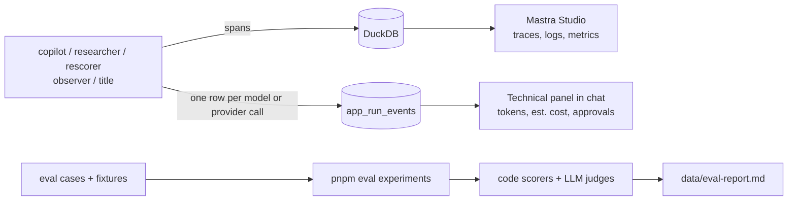

- Usage accounting: [apps/agent/src/usage/AGENTS.md](../apps/agent/src/usage/AGENTS.md).
- Evals and live scoring: [apps/agent/src/evals/AGENTS.md](../apps/agent/src/evals/AGENTS.md).
