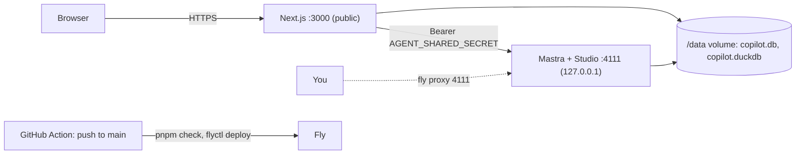

# Deployment (Fly.io)

One always-on Fly machine runs both servers from one image ([Dockerfile](../Dockerfile), [fly.toml](../fly.toml)). The database lives on a Fly volume. Only the web app is public, behind a password login. App `job-copilot-c456e8`, region `fra`, URL https://job-copilot-c456e8.fly.dev.

Why not Vercel: the app needs a persistent disk (libSQL + DuckDB files), long streaming runs, and an in-process scheduler for job discovery.

## How it runs

- [scripts/start-prod.sh](../scripts/start-prod.sh) is the container entrypoint. It runs the bundled agent from the repo root: `mastra build` writes its own `pnpm-workspace.yaml` into `.mastra/output`, and `findWorkspaceRoot()` would stop there and miss the migrations. It refuses to start without `APP_PASSWORD` (at least 12 characters), `AGENT_SHARED_SECRET` and `AI_GATEWAY_API_KEY`. It then starts the bundled agent and `next start`, and exits when either one dies, so Fly restarts the machine.
- Migrations run on first database use in both processes. There's no release step, which would run on a machine without the volume.
- `TZ = "Europe/Budapest"` in `fly.toml` `[env]`: times rendered on the server (pages, the agents' "today") use the user's zone. The discovery schedule has its own `DISCOVERY_TZ`.
- `auto_stop_machines = "off"`: scheduled workflows need the process up. Size is `shared-cpu-1x` with 1 GB RAM plus 1 GB swap, about $6–8/month with the 3 GB volume.
- **Login** (`APP_PASSWORD` set): `/login` takes only a password. A hidden fixed username lets password managers save it. The session is a 30-day HttpOnly cookie signed with `AGENT_SHARED_SECRET` (`apps/web/src/server/session.ts`, checked in `src/proxy.ts`). Changing the password signs every session out. Ten failures from one client lock it out for 10 minutes. Locally `APP_PASSWORD` is unset and nothing changes.
- The image build trims the lockfile's first YAML document, because Mastra 1.81's bundler can't parse pnpm 12's multi-document lockfile.

## Secrets

Set them with `pnpm fly:secrets` ([scripts/fly-secrets.sh](../scripts/fly-secrets.sh)), in your own terminal:

- It asks for `APP_PASSWORD`.
- It generates a fresh production `AGENT_SHARED_SECRET`.
- It copies `AI_GATEWAY_API_KEY`, `TAVILY_API_KEY` and `FIRECRAWL_API_KEY` from `apps/agent/.env`.

No value is printed or written to disk. Running it again rotates the password and the shared secret. For a single change, use `fly secrets set NAME=…` (restarts the machine), and `fly secrets list` to check (shows digests only).

GitHub holds the repo secret `FLY_API_TOKEN`: a deploy token for this app only (`fly tokens create deploy`). An optional `SENTRY_AUTH_TOKEN` uploads source maps ([Sentry](#sentry)).

Discovery: `pnpm fly:secrets` also copies `APIFY_API_KEY`, `HIMALAYAS_API_KEY`, `RESEND_API_KEY`, `DIGEST_FROM` and `DIGEST_TO` when they are set locally, and `APP_BASE_URL` in `fly.toml` points digest links here. The schedule (twice a day, `0 7,16 * * *` in `DISCOVERY_TZ`) runs on Fly once `DISCOVERY_SCHEDULE=on` is set there (`fly secrets set DISCOVERY_SCHEDULE=on`, or in `fly.toml` `[env]`): `discoveryScheduleEnabled()` allows it in the production image (`NODE_ENV=production`). Turn it off locally then (`DISCOVERY_SCHEDULE=off` in the main checkout's `apps/agent/.env`), or both machines run, bill and email against their own databases. Manual runs from `/discovery` always work.

## Deploys

- **Normal:** merge to `main`. [.github/workflows/deploy.yml](../.github/workflows/deploy.yml) runs `pnpm check`, then `flyctl deploy --remote-only` (built on Fly's builders). Expect a few seconds of downtime per deploy, since there's one machine.
- **Manual:** "Run workflow" on the Deploy action. Agents never run `fly deploy` from a worktree: there is one machine, so a branch deploy replaces whatever `main` (or another session) just shipped. Only for an outage fix, and say so; then merge it right away.
- **Rollback:** `fly releases --image`, then `fly deploy --image <previous image>`.

## Sentry

Errors from both servers and the browser go to the Sentry project `job-copilot` (org `denes-43421`, https://denes-43421.sentry.io/projects/job-copilot/), told apart by the `service` tag (`agent`, `web`). It's on only in the production image: the SDKs initialize when `NODE_ENV=production` and a DSN is set, and the DSN exists only in `fly.toml` `[build.args]`. So `pnpm dev`, tests, e2e and evals send nothing. A local production run sends events only if you pass the DSN yourself (use `SENTRY_ENVIRONMENT` / `NEXT_PUBLIC_SENTRY_ENVIRONMENT=verification` so they don't mix with production).

- **Agent** (`apps/agent/src/sentry.ts`): errors only. Mastra keeps the traces. It reports unhandled route errors (`server.onError`; HTTP 4xx stays out), failed chat runs, failed discovery sources (tag `source`; the run continues with the others) and failed "Assess fully" runs. Expected failures the model sees (fetch errors, `AssessmentError`) aren't reported. `bundler.sourcemap` + `node --enable-source-maps` keep its frames on `src/` files.
- **Web** (`apps/web/src/instrumentation*.ts`, `src/lib/sentry.ts`, `app/global-error.tsx`): server/edge request errors (`onRequestError`), browser errors and render crashes, plus 10% of requests as traces.
- **Privacy:** Sentry v11 collects headers, cookies, bodies, query strings, user info and model I/O by default, so every runtime passes `SENTRY_DATA_COLLECTION` (`packages/shared/src/sentry.ts`) with all of them off. No session replay. Sentry still infers the client IP server-side unless the project's "Prevent Storing of IP Addresses" setting is on.
- **Release:** the deploy workflow passes `SENTRY_RELEASE=<commit SHA>` as a build arg.
- **Source maps** (readable browser frames): add a Sentry auth token as the GitHub repo secret `SENTRY_AUTH_TOKEN` (an org token with `project:releases` / source-map upload scope). The workflow passes it as a Docker build secret, and `next build` uploads the maps. Without it, deploys still work but browser frames stay minified.

## Operating

| Task | Command |
| --- | --- |
| Logs | `fly logs` |
| Status / restart | `fly status`, `fly machine restart` |
| Studio (traces, logs, metrics) | `fly proxy 4111`, then http://localhost:4111 (never public; the agent listens on Fly's private network, `AGENT_HOST="::"`). Login steps: [README](../README.md#mastra-studio-on-fly) |
| Shell | `fly ssh console` |
| Backups | daily volume snapshots, 5 kept: `fly volumes snapshots list <vol-id>` |
| Restore | `fly volumes create copilot_data --snapshot-id <id> --region fra`, then move the machine to it |

**Copying a database in:** make a consistent copy (`sqlite3 data/copilot.db ".backup /tmp/copilot.db"`, safe while the app runs). Upload it next to the live file with `fly ssh sftp shell`, then `put /tmp/copilot.db /data/copilot.db.import`, and run `fly machine restart`. [scripts/start-prod.sh](../scripts/start-prod.sh) swaps it in before the servers start and keeps the old file as `/data/copilot.db.before-import`. The initial production data was copied this way from the local `data/copilot.db`.

**Copying it out:** `fly ssh console -C "sqlite3 …"` isn't available in the image. Use `fly ssh sftp get /data/copilot.db` while the app is idle, or restore a volume snapshot.
