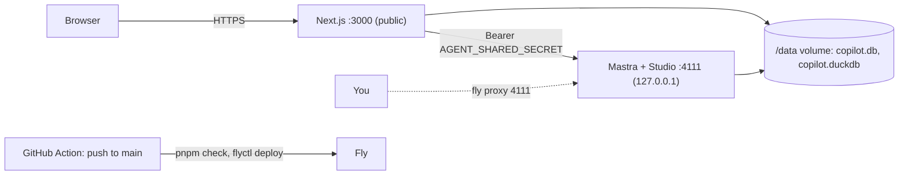

# Deployment (Fly.io)

One always-on Fly machine runs both servers from one image ([Dockerfile](../Dockerfile), [fly.toml](../fly.toml)). The database lives on a Fly volume. Only the web app is public, behind a password login. App `job-copilot-c456e8`, region `fra`, URL https://job-copilot-c456e8.fly.dev.

Why not Vercel: the app needs a persistent disk (libSQL + DuckDB files), long streaming runs, and an in-process scheduler for job discovery.

## How it runs

- [scripts/start-prod.sh](../scripts/start-prod.sh) is the container entrypoint. It refuses to start without `APP_PASSWORD` (at least 12 characters), `AGENT_SHARED_SECRET` and `AI_GATEWAY_API_KEY`. It then starts the bundled agent and `next start`, and exits when either one dies, so Fly restarts the machine.
- Migrations run on first database use in both processes. There's no release step, which would run on a machine without the volume.
- `auto_stop_machines = "off"`: scheduled workflows need the process up. Size is `shared-cpu-1x` with 1 GB RAM plus 1 GB swap, about $6–8/month with the 3 GB volume.
- **Login** (`APP_PASSWORD` set): `/login` takes only a password. A hidden fixed username lets password managers save it. The session is a 30-day HttpOnly cookie signed with `AGENT_SHARED_SECRET` (`apps/web/src/server/session.ts`, checked in `src/proxy.ts`). Changing the password signs every session out. Ten failures from one client lock it out for 10 minutes. Locally `APP_PASSWORD` is unset and nothing changes.
- The image build trims the lockfile's first YAML document, because Mastra 1.81's bundler can't parse pnpm 12's multi-document lockfile.

## Secrets

Set them with `pnpm fly:secrets` ([scripts/fly-secrets.sh](../scripts/fly-secrets.sh)), in your own terminal:

- It asks for `APP_PASSWORD`.
- It generates a fresh production `AGENT_SHARED_SECRET`.
- It copies `AI_GATEWAY_API_KEY`, `TAVILY_API_KEY` and `FIRECRAWL_API_KEY` from `apps/agent/.env`.

No value is printed or written to disk. Running it again rotates the password and the shared secret. For a single change, use `fly secrets set NAME=…` (restarts the machine), and `fly secrets list` to check (shows digests only).

GitHub holds one repo secret, `FLY_API_TOKEN`: a deploy token for this app only (`fly tokens create deploy`).

Later: the job-discovery schedule needs `DISCOVERY_SCHEDULE = "on"` in `fly.toml` `[env]`, and the email digest needs `RESEND_API_KEY` as a secret.

## Deploys

- **Normal:** merge to `main`. [.github/workflows/deploy.yml](../.github/workflows/deploy.yml) runs `pnpm check`, then `flyctl deploy --remote-only` (built on Fly's builders). Expect a few seconds of downtime per deploy, since there's one machine.
- **Manual:** `fly deploy` from a clean checkout, or "Run workflow" on the Deploy action.
- **Rollback:** `fly releases --image`, then `fly deploy --image <previous image>`.

## Operating

| Task | Command |
| --- | --- |
| Logs | `fly logs` |
| Status / restart | `fly status`, `fly machine restart` |
| Studio (traces, logs, metrics) | `fly proxy 4111`, then http://localhost:4111 (never public) |
| Shell | `fly ssh console` |
| Backups | daily volume snapshots, 5 kept: `fly volumes snapshots list <vol-id>` |
| Restore | `fly volumes create copilot_data --snapshot-id <id> --region fra`, then move the machine to it |

**Copying a database in or out:** stop writes first. Run `fly ssh console -C "pkill -f next"`, or scale to 0 and use a temporary machine. Then use `fly ssh sftp get /data/copilot.db` or `put`. The initial production data was copied once from the local `data/copilot.db`.
