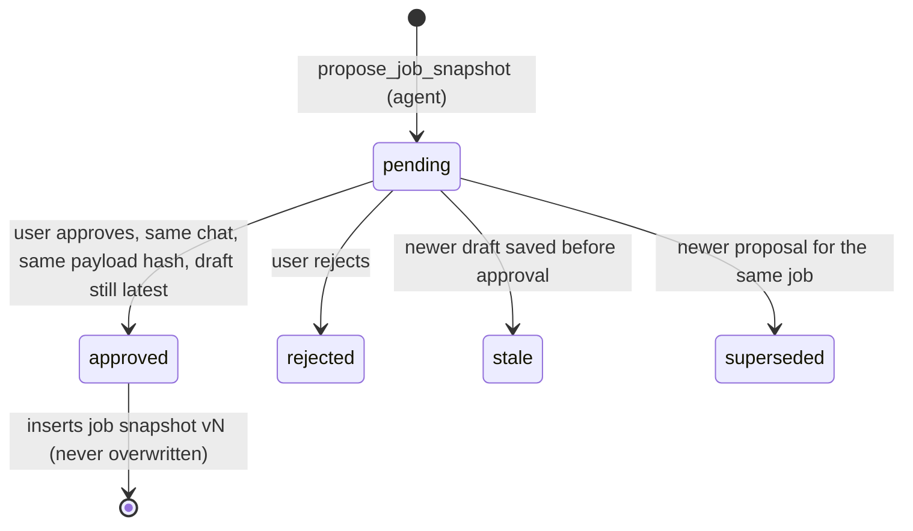

# packages/db — app tables and data access

Drizzle schema (`src/schema.ts`, `app_*` tables), migrations in `drizzle/` (generate with `pnpm --filter @copilot/db generate`; apps apply them via `migrateDb()` on first use). Agents and the web app call the functions exported from `src/index.ts`; no raw SQL outside this package.

- `jobs.ts`: `upsertJob` (dedupe: LinkedIn id → canonical URL → normalized company+title without conflicting ids), `addSource` (bounded snapshot, idempotent per job + content hash).
- `assessments.ts`: versioned drafts (with the profile version at save time), snapshot proposals, the approval decision, read models (incl. `profileStale`).
- `profile.ts`: current profile/version, profile change proposals, applying an approved change, history.
- `jobs.ts` also maintains `app_jobs_fts` (FTS5) via `reindexJob`; `searchJobIds` only builds quoted prefix terms.
- Every write function goes through `serializeWrites` (`write-lock.ts`): libsql's native calls are synchronous, so two write transactions in one process deadlock instead of queueing. `createDb` sets a 5 s busy timeout for the other process (agent vs web).

## Job snapshot approvals

- Only `decideApproval` changes status, and only the web app's server action calls it (user click). No tool can approve.
- A decision from another chat returns `wrong_thread`; a changed payload returns `stale`; repeating a decision that already happened returns the same result (lost-response retry), and concurrent approvals create one snapshot.
- Proposals are idempotent per draft + chat (`idempotency_key`). `payload` is exactly what gets stored; `payload_hash` is `hashPayload(payload)` (sorted-key JSON, SHA-256).
- Drafts must cite only sources of the same job; `official`/`independent`/`anonymous` evidence needs at least one source id.

## Profile change approvals

Same statuses and rules as snapshots. The payload lists each change with the fact's text before it, and `baseVersion`. Approving applies all changes as one new profile version (modify/remove set `superseded_in_version`; modify inserts a new fact with `supersedes_id`). If the profile moved past `baseVersion`, the approval becomes `stale` and nothing applies.
