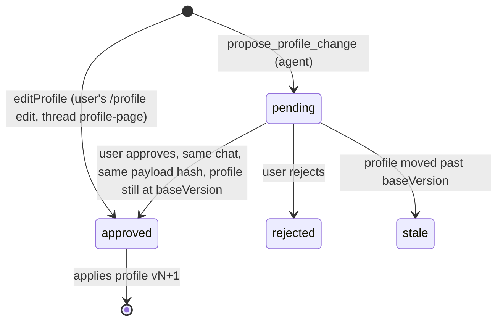

# packages/db — app tables and data access

Drizzle schema (`src/schema.ts`, `app_*` tables), migrations in `drizzle/` (generate with `pnpm --filter @copilot/db generate`; apps apply them via `migrateDb()` on first use). Agents and the web app call the functions exported from `src/index.ts`; no raw SQL outside this package.

- `jobs.ts`: `upsertJob` (dedupe: LinkedIn id → ATS key → canonical URL → company key + normalized title without conflicting ids; never touches status; `{ touch: false }` keeps `updatedAt`), `setJobStatus` / `setJobArchived` (the user's pipeline: `new → shortlisted → applied → interviewing → offer`, plus `rejected` / `dismissed`, which archive the job; any other status unarchives it; archiving by hand keeps the status; assessments are untouched; re-score skips archived jobs), `findJobByUrl` (saved job for a listing URL without fetching: LinkedIn id, ATS key, canonical URL, or a `linkedin`/`ats` snapshot URL; compared via `canonicalWebUrl` from `url.ts`, also for stored URLs with tracking parameters), `addSource` (bounded snapshot, idempotent per job + content hash; also stores the posting date the snapshot states, `listingPostedDate` from `@copilot/shared`: `posted_at` + `posted_basis` `exact`/`relative`/`reposted`/`none`, null = not parsed yet, filled by `backfillPostedDates` in `migrateDb`; after a parser change, a migration that sets `posted_basis` to null re-parses), `latestListingSource` / `isListingSource` (research pages are `web` sources too; only the job's own URL counts). A job's posted date is the latest dated listing source (`listJobs` `postedAt`, `getJobDetail` `posted`).
- `assessments.ts`: versioned assessments in `app_job_drafts` (no approval: the latest version is current, earlier ones are history; each records the profile version at save time, and an optional expected `profileVersion` rejects it if the profile moved), read models (`listJobs`, `getJobDetail` with `draft` + `history`, incl. `profileStale`).
- `profile.ts`: current profile/version, profile change proposals and the approval decision (`decideApproval`), `editProfile` (the user's own `/profile` edit: applied at once, recorded as an approved change), history. Every fact has a permanent `handle` (next free number, never reused; modify creates a new one); models see and cite it as `f<handle>` (`factHandle`), never the UUID, because they miscopy UUIDs.
- `claims.ts`: research claims (`recordClaim` enforces sources of the same job for sourced evidence classes), `listClaims`.
- `runs.ts`: chat runs (`startRun`, `endRun` keeps the first final status, `activeRun`, `interruptStaleRuns` at startup), run events (`recordRunEvents`, `totalsOf`, `threadUsage`).
- `jobs.ts` also maintains `app_jobs_fts` (FTS5) via `reindexJob`; `searchJobIds` only builds quoted prefix terms.
- Every write function goes through `serializeWrites` (`write-lock.ts`): libsql's native calls are synchronous, so two write transactions in one process deadlock instead of queueing. `createDb` sets a 5 s busy timeout for the other process (agent vs web).

## Discovery

`discovery.ts`, with the screen in `@copilot/shared` (`screening.ts`, `search-settings.ts`, `posting.ts`). The runner: [apps/agent/src/discovery/AGENTS.md](../../apps/agent/src/discovery/AGENTS.md).

- **`app_postings`**: one row per (`source`, `external_id`).
  - **`recordPosting`:**
    - A known posting only bumps `last_seen_at`. Its job row is untouched (`upsertJob` `{ touch: false }`), so list order stays stable.
    - A new posting failing the screen stays a posting with `screen_reasons`.
    - A passing one is deduped into `app_jobs` (`origin = discovery`) and gets a `board` source (`ats` for the career-sites feed, which reads the employer's own posting): `postingSnapshot`, whose header states Posted/Salary/Location, so the posted-date parser and the salary rule work.
  - **Dedupe:** the ATS key of the apply URL (below), a shared off-board apply URL (ATS or company site) as `canonical_url`, else `dedupe_key` = `companyKey(company)|normalized title`. Board URLs are never `canonical_url`: `compatible()` would block the cross-board match.
- **Visibility:** `visibleJobs(threshold)` is used by `listJobs` unless `{ includeHidden }`, so `/jobs`, `find_saved_jobs` and re-score all see only these. A job is visible when:
  - it came from chat, was kept (`kept_at`), or has any status but `new`; or
  - one of its postings passes and its triage score (once set) reaches the threshold.
- **`rescreenPostings`**: run after a settings change.
  - Age is judged as of arrival, with the backfill window of the run that brought the posting (`first_run_id` → `lookback_days`).
  - Newly passing postings are promoted. Discovered jobs whose postings all fail now hide.
- **`app_search_settings`**: one JSON row, parsed with `parseSearchSettings` (defaults fill missing fields).
- **`app_discovery_runs`**:
  - one running at a time (`startDiscoveryRun` returns null otherwise)
  - per-source results as JSON (`recordSourceResult`)
  - `sourceStates` derives each source's cursor (last good run) and health
  - `sourceSpendSince` gives the Apify budget
- **Triage and matches:**
  - `jobsAwaitingTriage` / `countAwaitingTriage`: untouched discovered jobs (`new`, not archived, a passing posting) without a score.
  - `saveTriage` stores score, reason and the profile version.
  - `jobsToAssess`: triaged since the run started, at or above the threshold, without a draft, best first.
  - `digestMatches`: the run's matches for the email.
  - `markJobSeen` / `unseenMatchCount`: the "new matches" badge.
  - `recordFunnel` stores the run's funnel; a run's `estimated_usd` = sources' provider cost + the funnel's model cost.
- **The job list at volume** (`job-list.ts`): `listJobsPage` (one page: tab, search ids, filters for source / minimum match / posted within / unseen, `latest` or `fit` order, total), `jobTabCounts`, `assessedJobCounts` (Re-score banner). `fit` order uses `matchScoreSql`: a with-profile assessment's fit level mapped to the triage scale (strong 95, good 80, mixed 60, weak 35, poor 15), else the triage score; unscored last. Also `belowThresholdJobs` and `screenedOutPostings` (Screened out tab), `keepJob` / `keepPosting` ("Keep anyway": `kept_at`; a kept posting is promoted to a job), `setJobsStatus` (bulk), `companyJobCounts` / `companyJobs` (company pages), `staleTriageCount` / `resetStaleTriage` (re-triage after a profile change). `listJobs` stays the full-list read for tools and re-score.
- **`ats_key`** (`ats.ts`, unique on jobs): `atsKey(url)` reads `greenhouse:<board>:<id>`, `lever:<company>:<uuid>`, `ashby:<company>:<uuid>` or `workable:<account>:<shortcode>` from any URL form of the job (host variants, `/apply`, query, the Greenhouse embed), so the same ATS job from two boards or a chat link is one job. `upsertJob` derives it from `canonicalUrl`; jobs with different keys never merge by title, and a job matched another way never takes a key another job holds. `backfillAtsKeys` (in `migrateDb`) fills older jobs. Pure parsing, no fetch.
- **`company_key`** is on jobs too. `backfillCompanyKeys` (in `migrateDb`) fills it and recomputes `dedupe_key` for older jobs.
- **Run markers:** `latestRunStatuses` skips `discovery:%` threads (discovery usage, M14), so they never show as chats.

## Profile change approvals

- Only `decideApproval` decides a pending change, and only the web app's server action calls it (user click). No tool can approve.
- A decision from another chat returns `wrong_thread`; a changed payload returns `stale`; repeating a decision that already happened returns the same result (lost-response retry), and concurrent approvals apply once.
- Proposals are idempotent per chat + payload (`idempotency_key`). `payload` is exactly what gets applied; `payload_hash` is `hashPayload(payload)` (sorted-key JSON, SHA-256). It lists each change with the fact's text before it, and `baseVersion`.
- Approving applies all changes as one new profile version (modify/remove set `superseded_in_version`; modify inserts a new fact with `supersedes_id`). If the profile moved past `baseVersion`, the approval becomes `stale` and nothing applies.
- `editProfile` checks the `baseVersion` the page showed and throws `AssessmentError` if the profile moved.

## Assessment rules

Assessments must cite only sources of the same job; `official`/`independent`/`anonymous` evidence needs at least one source id. Fit points (`profileFactIds` set) must be `inference` and cite current profile facts by handle or full id (`resolveFactRef`; the full id is stored; an unknown one errors with the current handles); `with_profile` assessments need at least one, `role_only` ones none. `salary` needs at least one amount, and every amount must appear in one of the job's sources, compared by value (`salaryFiguresMissing`: "75k" = "75,000"), so pay is never estimated. `resetAppTables` (index.ts) empties every app table, for the eval DB only.
