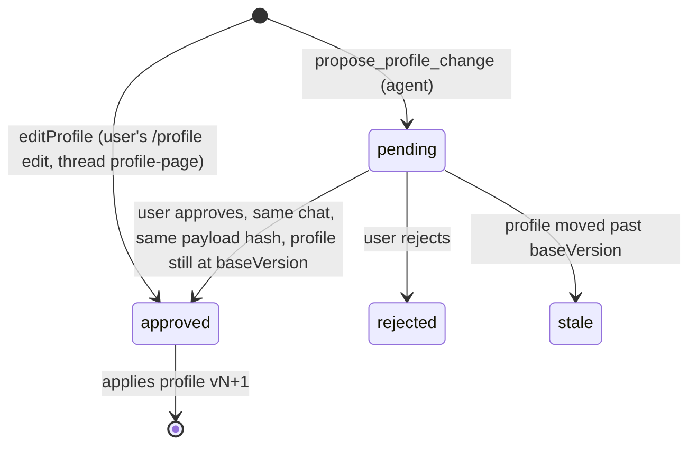

# packages/db — app tables and data access

Drizzle schema (`src/schema.ts`, `app_*` tables), migrations in `drizzle/` (generate with `pnpm --filter @copilot/db generate`; apps apply them via `migrateDb()` on first use). Agents and the web app call the functions exported from `src/index.ts`; no raw SQL outside this package.

- `jobs.ts`: `upsertJob` (dedupe: LinkedIn id → canonical URL → normalized company+title without conflicting ids; never touches status), `setJobStatus` / `setJobArchived` (the user's pipeline: `new → shortlisted → applied → interviewing → offer`, plus `rejected` / `dismissed`, which archive the job; any other status unarchives it; archiving by hand keeps the status; assessments are untouched; re-score skips archived jobs), `addSource` (bounded snapshot, idempotent per job + content hash), `latestListingSource` (research pages are `web` sources too; only the job's own URL counts).
- `assessments.ts`: versioned assessments in `app_job_drafts` (no approval: the latest version is current, earlier ones are history; each records the profile version at save time, and an optional expected `profileVersion` rejects it if the profile moved), read models (`listJobs`, `getJobDetail` with `draft` + `history`, incl. `profileStale`).
- `profile.ts`: current profile/version, profile change proposals and the approval decision (`decideApproval`), `editProfile` (the user's own `/profile` edit: applied at once, recorded as an approved change), history. Every fact has a permanent `handle` (next free number, never reused; modify creates a new one); models see and cite it as `f<handle>` (`factHandle`), never the UUID, because they miscopy UUIDs.
- `claims.ts`: research claims (`recordClaim` enforces sources of the same job for sourced evidence classes), `listClaims`.
- `runs.ts`: chat runs (`startRun`, `endRun` keeps the first final status, `activeRun`, `interruptStaleRuns` at startup), run events (`recordRunEvents`, `totalsOf`, `threadUsage`).
- `jobs.ts` also maintains `app_jobs_fts` (FTS5) via `reindexJob`; `searchJobIds` only builds quoted prefix terms.
- Every write function goes through `serializeWrites` (`write-lock.ts`): libsql's native calls are synchronous, so two write transactions in one process deadlock instead of queueing. `createDb` sets a 5 s busy timeout for the other process (agent vs web).

## Profile change approvals

- Only `decideApproval` decides a pending change, and only the web app's server action calls it (user click). No tool can approve.
- A decision from another chat returns `wrong_thread`; a changed payload returns `stale`; repeating a decision that already happened returns the same result (lost-response retry), and concurrent approvals apply once.
- Proposals are idempotent per chat + payload (`idempotency_key`). `payload` is exactly what gets applied; `payload_hash` is `hashPayload(payload)` (sorted-key JSON, SHA-256). It lists each change with the fact's text before it, and `baseVersion`.
- Approving applies all changes as one new profile version (modify/remove set `superseded_in_version`; modify inserts a new fact with `supersedes_id`). If the profile moved past `baseVersion`, the approval becomes `stale` and nothing applies.
- `editProfile` checks the `baseVersion` the page showed and throws `AssessmentError` if the profile moved.

## Assessment rules

Assessments must cite only sources of the same job; `official`/`independent`/`anonymous` evidence needs at least one source id. Fit points (`profileFactIds` set) must be `inference` and cite current profile facts by handle or full id (`resolveFactRef`; the full id is stored; an unknown one errors with the current handles); `with_profile` assessments need at least one, `role_only` ones none. `resetAppTables` (index.ts) empties every app table, for the eval DB only.
